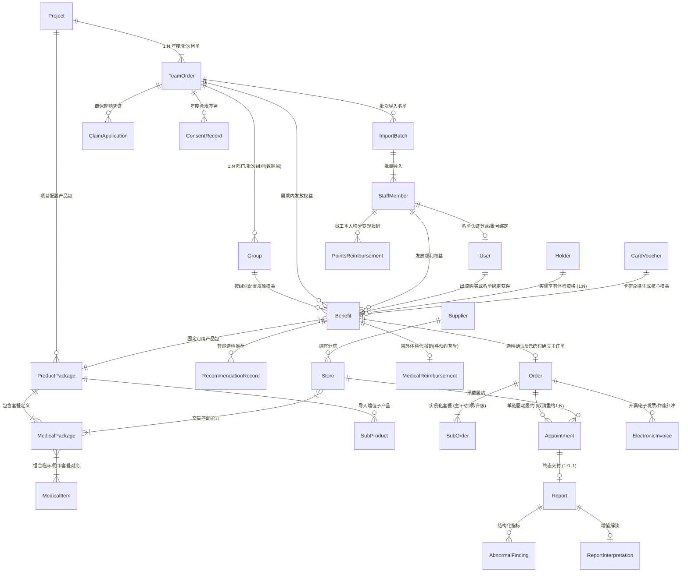
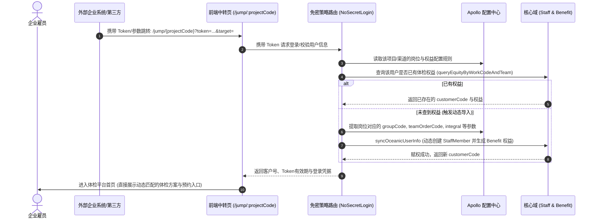

# 体检系统（HMSC）领域实体（Entities）全景规范

> 本文档沉淀体检业务核心域及周边子域中的所有**实体（Entity）**定义，明确其聚合归属、唯一标识（Identity）、生命周期流转、领域行为与业务不变量（Invariants）。

---

## 一、实体清单总览 (按限界上下文划分)

| 序号 | 实体名称 (Entity) | 聚合根/内部实体 | 业务唯一标识 (Identity) | 核心职责 | 对应底层主表/类 |
|:---|:---|:---|:---|:---|:---|
| **1** | **Project (企业项目)** | **聚合根** | `projectCode` / `projectId` | 面向大客户/租户的长期规则、门户入口、项目生命周期与项目级配置根（核心端为主权威源，MIS 为补充），与团单 1:N | 企业项目配置主表 / 核心配置 |
| **2** | **TeamOrder (团单)** | **聚合根** | `teamOrderCode` | 归属于企业项目下的具体年度/批次合同与福利周期实例，管控权益有效期、商保理赔标识与年度承诺书周期 | 团单主表 / `teamOrderCode` |
| **2a** | **Group (组别)** | 内部实体 (`TeamOrder`) | `(projectCode, teamOrderCode, groupCode)` | 团单下的二级配置分组（部门/职级/批次），承接差异化权益套餐范围与发放规则；属数据层概念，前台文案不露出 | `MEMBER_EWP_GROUP` / `MemberEwpGroupBean` |
| **3** | **ImportBatch (名单导入批次)** | **聚合根** | `batchSerialNo` / `importSerialNumber` | 记录企业大客户 HR 批量导入员工名单的批次凭据、处理状态与审计数据 | `MEMBER_EWP_IMPORT_RECORD` / `ImportRecordBean` |
| **4** | **StaffMember (企业名单员工/白名单)** | **聚合根** | `customerCode` / (项目编码+工号/证件号) | 企业 B2B 导入的受检白名单人员，承载企业身份、在职状态、家属关系，作为员工登录鉴权与建档依据 | `MEMBER_EWP_STAFF_MEMBER` / `EwpStaffMemberBean` |
| **5** | **Benefit / Equity (用户体检权益)** | **聚合根** | `importSerialNumber` / `equityId` | 持有人享有的体检资格凭据，记录起止有效期、可用次数与锁定状态，是创建主订单与发起预约的前置门禁 | `MEMBER_EWP_EQUITY` / `StaffMemberBenefitBean` |
| **6** | **ProductPackage (产品包/权益包)** | **聚合根** | `packageCode` / `packageId` | 企业大客户维度的权益集合容器，区分员工专属(P)与家属(G)，管控统付范围与可约分院名单 | `MEMBER_EWP_PACKAGE_MAIN` / `EwpPackageMainBean` |
| **7** | **MedicalPackage (体检套餐)** | **聚合根** | `packetCode` / `packetId` | 临床体检科目组合，细分为标准主套餐(00)、升级套餐(02)、加价套餐(03)、自选加项包(01) | `MEMBER_EWP_PACKET_MAIN` / `PackageBean` |
| **8** | **SubProduct (增值子产品)** | 实体 (挂载产品包) | `productCode` / `productId` | 产品包项下的增值服务产品（如 C24/C59 异步医生解读），大客户导入赋权 | `MEMBER_EWP_PRODUCT_MAIN` / `EwpProductMainBean` |
| **9** | **MedicalItem (临床体检项目)** | 实体 / 字典实体 | `itemId` / `itemCode` | 平台统一标准医学临床科目，用于跨机构映射、互斥校验与多套餐对比 | `PhysicalProjectBean` / 标准医学字典 |
| **10** | **RecommendationRecord (智能推荐记录)** | **聚合根** | `reportRequestId` / 测评记录ID | 承接 AI 问卷测评或历史报告异步推荐状态、主套餐/加项包推荐分值、补充检查项与历史测评复用 | `AiRecommendPackageResultDTO` / 测评推荐表 |
| **11** | **Order (主订单)** | **聚合根** | `orderId` / `mainOrderCode` | 承接体检权益并承载交易结算与履约状态的凭据（含 0 元统付单），严格遵循 `Benefit ➔ Order ➔ Appointment` 单链 | `MEMBER_EWP_ORDER_MAIN` / `EwpOrderMainBean` |
| **12** | **SubOrder (子订单)** | 内部实体 (Order) | `subOrderId` | 区分费用归属(统付/自费)与套餐包性质，承载明细级SKU穿透与积分分摊 | `MEMBER_EWP_ORDER_SUB` / `EwpOrderSubBean` |
| **13** | **Holder (持有人/体检人)** | 独立实体 | `holderId` (证件类型+证件号) | 实际执行体检的自然人主体，一笔主订单严格绑定单一持有人 | `MEMBER_EWP_ORDER_HOLDER` / `OrderHolderBean` |
| **14** | **Appointment (预约单)** | **聚合根** | `appointmentId` / `appointmentCode` | 依附于主订单锁定分院与档期的履约凭据，状态流转中枢 | `MEMBER_EWP_ORDER_APPOINT` / `AppointmentBean` |
| **15** | **Store (体检分院/门店)** | **聚合根** | `storeId` / `storeCode` | 线下物理体检网点，维护营业状态与套餐设备履约能力 | 分院配置表 / `StoreBean` |
| **16** | **Supplier (供应商/机构)** | **聚合根** | `supplierId` / `supplierCode` | 区分线上直连集团(API锁单)与公立医院(人工确认排期) | 供应商表 / `SupplierBean` |
| **17** | **Report (体检报告)** | **聚合根** | `reportId` | 到检后的总检成果及PDF文件，经大模型OCR抽取归档至HMES | `MEMBER_EWP_USER_REPORT` / `UserReportBean` |
| **18** | **ReportInterpretation (报告解读工单)** | 实体 (核心HMC托管，挂载Report/Order) | `interpretReportId` | HMC 核心托管的 C24/C59 异步专科医生解读工单，支持手动提前/到检申请与四条件出报告自动申请，附件归档至 HMES | HMC 核心托管 / `PastReportServiceImpl` (`interpretEwpReportApply`) |
| **19** | **CartItem (购物车项)** | 实体 (草稿容器) | `cartItemId` | 意向体检草稿，承载单持有人套餐与门店意向排期（加车不占容） | `MEMBER_SHOP_CART` / `ShoppingCartBean` |
| **20** | **CombinationOrder (组合订单)** | 瞬态聚合根 | `combinationOrderId` | 多车项合并结算凭据，仅用于收银台合并扣积分与调起支付 | 瞬态交易实体 (支付后即解体) |
| **21** | **CardVoucher (体检卡券/卡密)** | **聚合根** | `voucherId` / `cardPassword` | 商城零售卡密，兑换后生成体检权益并立即进入不可退款状态 | `MEMBER_SHOP_VOUCHER` / `ProjectVoucherBean` |
| **22** | **ShadowLedgerRecord (双边镜像对账流水)** | 实体 | `ledgerId` | 外部积分两阶段消费时的本地防超扣镜像流水与审计账本 | `POINT_SHADOW_LEDGER` / 积分流水记录 |
| **23** | **ClaimApplication (商保理赔申请单)** | **聚合根** | `claimId` / (团单/保单+客户号) | 承载保单赠检直赔的身份证OCR影像、手写电子签名、动态合成理赔PDF及专线SFTP归档状态 | `EwpClaimsDataBean` / `EwpSwpClaimsDataBean` |
| **24** | **ConsentRecord (合规协议与承诺书签署记录)** | 实体 | `consentId` / (客户号+项目+团单) | 留痕一级隐私授权与二级企业定制劳资健康承诺书签署状态、哈希防篡改摘要与存证PDF，按年度团单周期绑定 | `MEMBER_EWP_CLAUSE` / `UndertakeLetterBean` |
| **25** | **User (用户账号/购买人)** | **聚合根** | `userId` | 平台主账号，负责登录、统一出资与家庭报告聚合查阅 | `MEMBER_USER` / `UserBean` |
| **26** | **MedicalReimbursement (体检代报销单)** | **聚合根** | `reimburseCode` | 承载体检报销(01)与复检报销(02)申请、个人/公司双抬头凭证、原件寄送核验与财务打款状态流转 | `MEMBER_EWP_USER_REIMBURSE` / `EwpUserReimburseBean` |
| **27** | **PointsReimbursement (积分报销单)** | **聚合根** | `reimburseCode` | 承载员工本人多品类个人健康消费发票报销，按1:1联动核心/薪福通/福粒积分两阶段冻结与实扣 | `MEMBER_EWP_KPMG_REIMBURSE` / `EwpKpmgReimburseBean` |
| **28** | **ConsultRecord (AI导医咨询记录)** | **聚合根** | `consultRecordCode` | 承载用户与小诺医生的症状导医问答会话、问诊摘要与推荐就诊科室，独立于体检报告解读工单 | `MEMBER_CONSULT_RECORD_MAIN` / `ConsultRecordMainBean` |
| **29** | **ElectronicInvoice (电子发票)** | **聚合根** | `invoiceCode` / `(mainOrderCode + 批次)` | 承接已支付体检主订单与已发货商城订单的电子开票、核心双边状态同步、作废与红冲，执行部分退款禁开票门禁 | `UserInvoiceServiceImpl` / `InvoiceStatusEnum` |

---

## 二、核心实体详细定义与业务不变量 (Invariants)

### 1. `ImportBatch`（名单导入批次）—— B2B 批次处理聚合根
* **概念定义**：企业 HR 或运营人员批量导入员工/家属名单时生成的批次记录与审计凭据。
* **唯一标识**：`batchSerialNo` / `importSerialNumber`（对应 `MEMBER_EWP_IMPORT_RECORD`，Bean 为 [`ImportRecordBean.java`](file:///D:/coder/代码/体检/hmsc-service/hmsc-service/hmsc-edge-enterprise/src/main/java/com/cignacmb/enterprise/bean/ImportRecordBean.java)）。
* **生命周期状态**：
  * `PARSING` (文件解析校验中)
  * `PROCESSING` (批量入库与生成权益中)
  * `COMPLETED` (处理完成 - 记录总数与失败数)
  * `FAILED` (批次失败 - 格式校验不通过或系统异常)
* **业务行为与不变量**：
  * **原子性与容错隔离**：批次记录必须完整留痕总导入数（`importCount`）、失败记录数（`failCount`）与完成时间；部分失败记录输出错误报表供 HR 修正重传。
  * **权益批量生成联动**：批次解析成功后，级联触发下游批量生成对应人员记录（`StaffMember`）与初始福利权益（`Benefit`）。

### 2. `StaffMember`（企业名单人员/白名单）—— 认证与主体实体
* **概念定义**：企业客户导入的员工或家属名单记录，是企业福利模式下自然人登录鉴权与受检资格的法定白名单。
* **唯一标识**：`customerCode`（客户/员工编码）或 `(projectCode + workCode / idnoCardcode)`（对应 `MEMBER_EWP_STAFF_MEMBER`，Bean 为 [`EwpStaffMemberBean.java`](file:///D:/coder/代码/体检/hmsc-service/hmsc-service/hmsc-edge-enterprise/src/main/java/com/cignacmb/enterprise/bean/EwpStaffMemberBean.java)）。
* **核心业务属性**：
  * **自然人四要素**：姓名（`customerName`）、证件类型（`cardType`）、证件号码（`cardCode`）、手机号（`userMobile`）。
  * **企业与组织属性**：企业编码（`companyCode`）、工号（`workCode`）、在职状态（`onWork`）、团单号（`teamOrderCode`）。
  * **受众与亲属关系**：人员类型（`customerType`: 01-员工, 02-家属）、关系类型（`relationCode`: 02-配偶, 03-子女, 04-父母, 05-岳父母）。
* **业务行为与不变量**：
  * **名单驱动免密/四要素登录鉴权**：在 B2B 企业入口，用户凭手机号验证码或“姓名+身份证/工号”四要素进行校验，通过白名单比对确认企业雇员身份。
  * **账号自动建档绑定**：首次登录时，系统依据名单四要素自动在 `MEMBER_USER` 生成登录主账号，并将 `StaffMember`、`Holder`（持有人）与系统账号完成三位一体绑定。
  * **在职/离职减员风控**：若企业 HR 提交减员导入或将 `onWork` 置为离职，系统自动同步冻结其未履约的福利权益。

### 3. `Benefit / Equity`（用户体检权益）—— 预约资格与门禁聚合根
* **概念定义**：持有人在特定企业项目（Project）及团单（TeamOrder）下享有的体检法定资格凭据。它决定了持有人“当前是否有资格体检”、“有几次免费/统付名额”、“能选哪些套餐”以及“最晚何时必须预约”。
* **唯一标识**：`importSerialNumber`（导入流水号）/ `equityId`（对应 `MEMBER_EWP_EQUITY`，Bean 包括 [`StaffMemberBenefitBean.java`](file:///D:/coder/代码/体检/hmsc-service/hmsc-service/hmsc-edge-enterprise/src/main/java/com/cignacmb/enterprise/bean/StaffMemberBenefitBean.java) 与 [`EwpEquityBean.java`](file:///D:/coder/代码/体检/hmsc-service/hmsc-service/hmsc-edge-enterprise/src/main/java/com/cignacmb/enterprise/bean/EwpEquityBean.java)）。
* **权益生成途径**：
  1. **企业 B2B 福利导入**：大客户 HR 在后台批量导入员工/家属名单，按团单号生成正式权益；
  2. **免密对接动态导入（JIT Dynamic Provisioning）**：外部企业系统免密单点登录（SSO）时，中转接口依据 Apollo 配置的岗位/规则字典，在无前置名单时实时动态匹配并生成权益；
  3. **卡券卡密兑换**：商城售出的体检卡券通过 `checkGardPassword` 兑换后在下游核心域生成持有人名下的正式权益；
  4. **自费购买转单**：自费优惠套餐支付成功后即时在持有人名下确立待预约权益。
* **生命周期状态**：
  * `EFFECTIVE` (有效待预约 - 拥有可用名额)
  * `LOCKED` (预约锁定中 - 关联了待就检的有效预约单)
  * `CONSUMED` (已核销闭环 - 分院已到检或报告已出具)
  * `EXPIRED` (已过期失效 - 超过有效截止期)
  * `REVOKED` (已作废 - HR 离职减员或工单退单核销)
* **业务行为与不变量**：
  * **预约门禁前置校验（`queryUsableFreeEquityCount`）**：持有人进入预约流程前，严格校验是否存在有效且未过期的体检权益（起止时间 `benefitStartTime` ~ `benefitEndTime`）。
  * **两阶段锁定与释放（Lock & Release）**：发起预约时调用 `lockForAppointment(appointmentId)` 冻结名额；若预约取消或超期未到检（Overdue No-show），自动调用 `releaseLock()` 恢复可用名额。
  * **权益到期预约拦截门禁（Equity Expiry Guard）**：权益过期后，现存预约单虽可取消但绝对禁止再次选店发起新预约，严格锁定企业福利预算敞口。

### 4. `Appointment`（预约单）—— 核心履约聚合根
* **概念定义**：依附于主订单（`Order`）存在，持有人锁定特定体检分院和预约日期的履约凭据，是整个体检履约链路的状态核心。
* **唯一标识**：`appointmentId` / `appointmentCode`
* **生命周期状态**：
  * `PENDING` (申请中 / 待确认 - 线下公立机构协调中)
  * `CONFIRMED` (预约成功 `02` - 线上直连实时锁定或公立确认)
  * `CHECKED_IN` (已到检 `04` - 确立供应商采购结算里程碑)
  * `REPORTED` (已出报告 `05` - 终态)
  * `CANCELLED` (已取消 - 终态)
  * `OVERDUE_RELEASED` (超期未到检已释放 - 终态)
  * `FAILED` (预约失败 `07` - 线上直连锁单超时/售罄即时落标)
* **业务行为与不变量**：
  * **原分院同店改期（Same-Store Reschedule）**：只允许在原预约分院内变更日期或时间段，禁止跨店改期；改期维持预约单号不变。
  * **当日不对称改退规则（Asymmetric Day-of Policy）**：体检日当天禁止主动取消预约，但允许在原分院内改期至后续可用日期。
  * **合并原子履约（Bundled Fulfillment）**：主套餐与所有加项包必须作为不可分割的履约整体打包交付分院，禁止拆单履约。
  * **取消与权益恢复联动**：预约单一旦取消或超期释放，必须触发领域事件驱动主订单恢复“待预约”状态。
  * **团检日标识动态落标（Group Checkup Day）**：复用标准线下预约单承载企业专场团检报名（`groupCheck`: `Y/N`），仅企业福利主订单的线下预约可命中团检日（线上直连与自费优惠单恒为 `N`）；原分院同店改期跨团检日/非团检日时同步刷新该标识。

### 5. `Order`（主订单）—— 权益与交易聚合根
* **概念定义**：承接体检权益并承载交易结算与履约状态的凭据，严格遵循 `Benefit ➔ Order ➔ Appointment` 单链归属（纯企业统付 0 元单自动视为已支付待预约）。
* **唯一标识**：`orderId` / `mainOrderCode`
* **生命周期状态**：
  * `WAIT_BUYER_PAY` (待支付)
  * `PAID_WAIT_APPOINT` (已支付 / 待预约)
  * `APPOINTED` (已预约 / 履约中)
  * `FINISHED` (已到检出具报告 / 交易闭环)
  * `REFUNDED` (已退款)
* **业务行为与不变量**：
  * **单一持有人约束（Single Holder Invariant）**：一笔主订单严格且仅对应一位持有人（Holder）。
  * **权益到期门禁（Equity Expiry Guard）**：权益过期后，现存预约单虽可取消，但禁止再次选店发起新预约。
  * **退款前置取消预约（Cancel Before Refund）**：发起退款前，关联的预约单必须处于已取消状态，释放排期名额后方可退款。

### 6. `ProductPackage`（产品包/权益包）—— 方案与权益聚合根
* **概念定义**：企业大客户（Project）维度的体检福利总包容器，代表一组授予员工或家属的可选福利方案范围。
* **唯一标识**：`packageCode` / `packageId`（对应 `MEMBER_EWP_PACKAGE_MAIN`）
* **生命周期状态**：
  * `DRAFT` (配置中草稿)
  * `ACTIVE` (已上线生效 / 销售中)
  * `SUSPENDED` (暂停服务)
  * `EXPIRED` (已失效下架)
* **业务行为与不变量**：
  * **受益人范围隔离（Beneficiary Scope）**：严格区分员工专属包（`P`）与家属包（`G`）。员工包享有企业统付补贴，家属包企业不予统付，走员工全额自费或纯积分划扣。
  * **门店白名单约束**：产品包配置绑定的合作供应商与可用体检分院清单，圈定持有人可履约的网点边界。
  * **挂载增值子产品（Sub-Product）**：C24/C59 异步医生解读等增值医疗服务作为子产品直接导入挂载赋权，不在商城零散零售。

### 7. `MedicalPackage`（体检套餐）—— 临床医学组合聚合根
* **概念定义**：体检中心实际履约交付的临床检查项目集合（即前台展示的各级套餐与加项包）。
* **唯一标识**：`packetCode` / `packetId`（对应 `MEMBER_EWP_PACKET_MAIN`）
* **套餐分类形态**：
  * **标准主套餐（`00`）**：企业统付的基准套餐（如青年基础体检、关爱中老年体检）。
  * **升级套餐（`02`）**：升舱高阶套餐，采用“升级价 - 统付基准价”差额补价算价。
  * **加价套餐（`03`）**：套餐科目与原主套餐完全一致，但因特定高端分院溢价而收取附加费（`extraPrice`）。
  * **自选加项包（`01`）**：叠加的专项筛查（如胃肠镜包、低剂量胸部螺旋CT包、肿瘤早筛包）。
* **业务行为与不变量**：
  * **适检人口属性门禁（Demographic Guard）**：套餐必须绑定适用性别（男/女/通用）与婚姻状况（未婚/已婚/不限），严格杜绝禁忌临床科目下单。
  * **医学互斥与加项上限（Add-on Exclusivity & Budget Cap）**：同类重复/冲突医学项目禁止并选；加项包自选总额严格受企业项目配置的限额（Budget Cap）管控。
  * **免费加项津贴规则（Free Add-on Allowance）**：企业方案可配置加项包免费津贴（按个数免费、按金额上限 `freeAdditionUpMoney` 免费及必选下限），并控制超出免费津贴后“禁止多选”或“允许自费/积分补差多选”（`morePayType`）。
  * **标准医学字典对齐**：外部机构异构项目必须对齐映射至平台标准字典（`PhysicalProjectBean`）。

### 8. `SubOrder`（子订单）—— 积分子项与成本分摊实体
* **概念定义**：主订单项下具体的体检项目包实例，包括主套餐、加项包、升级包和加价包。
* **唯一标识**：`subOrderId`
* **业务行为与不变量**：
  * **主干套餐单选互斥（Single-Core Package Invariant）**：单笔主订单项下，只能且必须在“标准主套餐(00)”、“升级套餐(02)”与“加价套餐(03)”中选定其一。
  * **积分抵扣优先级落标（Point Deduction Priority）**：积分抵扣严格按照“先主套餐升级/加价差额，后自选加项包”的顺序扣减，并落标到对应子订单中，实现明细级穿透记账。

### 9. `Store`（体检分院/门店）—— 资源与能力实体
* **概念定义**：供应商在具体地理位置设立的物理体检机构网点。
* **唯一标识**：`storeId`
* **业务行为与不变量**：
  * **套餐门店交集匹配（Intersection Matching）**：门店必须具备主套餐与所有用户选定加项包所需的全部检验设备与临床能力交集，方可对用户可见并提供预约。
  * **排期屏蔽日管控（Blackout Dates）**：命中企业项目屏蔽日的日期统一闭门不可选。
  * **停业策略（Suspension Visibility Policy）**：按项目策略执行“彻底隐藏”或“置灰并提示暂停服务”。

### 10. `Report`（体检报告）—— 成果与档案聚合根
* **概念定义**：体检中心在到检后出具的总检数据与原件文件。
* **唯一标识**：`reportId`
* **业务行为与不变量**：
  * **统一大模型 OCR 解析（LLM-OCR Ingestion）**：所有 PDF 报告经由统一管道解析并抽取临床异常指标，归档至 HMES，全面废弃老旧私有 JSON 接口。
  * **自主外院报告物理隔离（Past Report Isolation）**：用户上传的历史外院报告仅保存在端侧查看，严禁污染官方体检档案。

### 11. `CardVoucher`（体检卡券/卡密）—— 商城卡券聚合根
* **概念定义**：商城零售的体检兑换凭证。
* **唯一标识**：`voucherId` / `cardPassword`
* **业务行为与不变量**：
  * **卡密核销锁死边界（Voucher Non-Refundable Boundary）**：未兑换时仅允许客服在后台人工审核退款；一旦输入卡密兑换生成核心体检权益（Benefit），状态立即永久锁定不可退款。

### 12. `Project`（企业项目）—— 顶层租户与规则配置根
* **概念定义**：面向企业大客户/租户的长期规则、门户入口、项目生命周期与项目级别配置根。
* **唯一标识**：`projectCode` / `projectId`
* **核心职责与配置权威源**：
  * **核心端为主权威源，MIS 为补充**：项目级别核心配置以核心端为主权威源，MIS 后台（`hmsc-web-mis`）仅作补充配置入口。
  * **一对多团单归属（1:N）**：一个企业项目下可挂载多个年度或批次团单（`TeamOrder`）。
  * **项目级规则管控**：统一承载免密入口（`/jump/:projectCode`）、项目屏蔽日（Blackout Dates）、分院停业展示策略、排期时间段开关、团检报名专属线下门店白名单（`groupPhysicalExaminationStores`）、自选加项预算帽、普惠 AI 解读开关及产品包目录。

### 13. `TeamOrder`（团单）—— 年度/批次合同与福利周期聚合根
* **概念定义**：归属于特定企业项目（`Project`）下的具体年度或批次合同与福利周期实例（含团险核心同步而来的 EWP 保单团单）。
* **唯一标识**：`teamOrderCode`
* **业务行为与不变量**：
  * **组别二级收敛（`Group` 内部配置实体）**：团单下可划分多个 `Group`（`groupCode` / `groupName`，对应 `MemberEwpGroupBean`），用于按部门、职级或批次收敛差异化的权益套餐范围与免密动态赋权映射；**同一团单下允许单个员工同时归属多个组别（M:N）**。组别生命周期完全依附于团单，且属数据/配置层概念，不在前台界面露出“组别”文案。
  * **权益周期锚点**：限定当期导入员工名单（`ImportBatch`）与发放体检权益（`Benefit`）的法定起止有效期。
  * **商保理赔标识开关**：控制该团单是否激活商保直赔前置资料门禁（`claimsType`）。
  * **年度合规周期绑定**：决定企业定制劳资健康承诺书（`ConsentRecord`）的有效周期，跨年度团单开启须重新签署。

### 14. `RecommendationRecord`（智能推荐记录）—— 决策辅助聚合根
* **概念定义**：位于“权益确认”与“选套餐/加项”之间的可选智能选检记录，承接 AI 套餐推荐异步计算结果与历史测评复用（套餐对比 `comparePacket` 为无状态领域服务，基于 `MedicalItem` 实时计算，不单建实体）。
* **唯一标识**：`reportRequestId` / 测评记录 ID（对应 [`AiRecommendPackageResultDTO.java`](file:///D:/coder/代码/体检/hmsc-service/hmsc-service/hmsc-edge-enterprise/src/main/java/com/cignacmb/enterprise/bean/dto/AiRecommendPackageResultDTO.java)）
* **双入口与生命周期**：
  * **双入口**：健康问卷测评（`queryAIQuestionnaire`）或提交/引用历史体检报告（`recommendPacket/submitReport`）。
  * **异步状态**：`01-推荐中` ➔ `02-推荐完成` / `03-推荐失败`。
* **业务行为与不变量**：
  * 输出按推荐分值排序的主套餐推荐列表、加项包推荐列表、补充检查项及报告 AI 解读结论，支持回填至选套餐页默认自动勾选，且支持查询历史测评记录复用。

### 15. `ClaimApplication`（商保理赔申请单）—— 商保直赔聚合根
* **概念定义**：保单赠送体检（企业团险 EWP / 个人个险 SWP）商保直赔场景下的法定证据链与理赔归档实体。
* **唯一标识**：`claimId` / `(teamOrderCode/policyNo + customerCode)`（对应 `EwpClaimsDataBean` / `EwpSwpClaimsDataBean`）
* **业务行为与不变量**：
  * **前置资料门禁**：团单/保单开启理赔标识时，强制要求完成身份证正反面 OCR 与实时手写电子签名，否则阻断后续选检与预约流程。
  * **动态盖章合成与专线归档**：调用 `mergeClaimsData` 合成《体检理赔申请授权书 PDF》，通过 `ClaimsDataEvent` 经由内网专线 SFTP 自动推送至 211 保险核心结案。

### 16. `ConsentRecord`（合规协议与承诺书签署记录）—— 法务存证实体
* **概念定义**：记录持有人在分级合规门禁中签署《隐私政策/个人健康信息授权书》及企业定制《劳资健康承诺书》的法律存证实体。
* **唯一标识**：`consentId` / `(customerCode + projectCode + teamOrderCode)`（对应 `MEMBER_EWP_CLAUSE` / `UndertakeLetterBean`）
* **业务行为与不变量**：
  * **两级分阶段门禁**：一级门禁卡在登录/进入阶段；二级门禁（企业定制承诺书）卡在预约提交前，未签署（`flag == 02`）硬阻断提交。
  * **防篡改存证与年度重签**：签署时固化 `ShaRsaUtil` 哈希摘要并可触发定制邮件发送存证 PDF；有效性严格绑定年度团单生命周期，跨年度须重新签署。

### 17. `MedicalReimbursement`（体检代报销单）—— 体检与复检报销聚合根
* **概念定义**：持有人在院外自行完成体检或异常复查后，凭发票与凭证发起的费用代报销单据，涵盖平级的**体检报销（`01`）**与**复检报销（`02`）**两种类型。
* **唯一标识**：`reimburseCode`（对应 `MEMBER_EWP_USER_REIMBURSE`，Bean 为 [`EwpUserReimburseBean.java`](file:///D:/coder/代码/体检/hmsc-service/hmsc-service/hmsc-edge-enterprise/src/main/java/com/cignacmb/enterprise/bean/EwpUserReimburseBean.java)）。
* **生命周期状态**：
  * `01-审核中` ➔ `08-待寄送发票原件`（按项目/发票类型触发）➔ `02-待付款`（推送核心财务）➔ `03-已付款`（终态） / `05-付款失败`（可原单改卡重推回 `02`）
  * `04-已取消`（用户审核中主动撤销，终态） / `06-审核未通过`（驳回，终态）
* **业务行为与不变量**：
  * **预约与体检报销互斥（Benefit-Reimbursement Mutual Exclusion）**：同一 `importSerialNumber` 下，线上预约与体检报销（`01`）严格二选一；存在有效预约/订单或有效在途/已完结的体检报销单时，硬阻断另一条路径。
  * **复检共存独立赋权**：复检报销（`02`）面向首次体检异常后的二次复查，依托独立复检权益（`reimburseRecheckCode`）存在，可与首次体检（线上预约或体检报销）共存。
  * **受众与双抬头发票边界**：支持员工本人与家属代报销（`reimburseTarget`: `01-员工 / 02-家属`）；区分个人抬头（`nomMoney`）与公司抬头（`companyMoney`）金额，支持纸质原件寄送（`08`）审核环节。
  * **全额核准与原单改卡重推**：审核严格遵循“全额通过或整体驳回重提”，不做部分核减；核心打款失败（`05`）时维持原 `reimburseCode` 不变，用户修改收款银行卡后直接跳过人工复审置为 `02-待付款` 重新推送财务。

### 18. `PointsReimbursement`（积分报销单）—— 员工积分变现报销聚合根
* **概念定义**：仅限员工本人凭个人抬头健康消费发票（涵盖自选单项体检、疫苗、牙科、眼科、健身/瑜伽等），按 1:1 消耗其企业福利积分额度换取现金打款的报销单据。
* **唯一标识**：`reimburseCode`（对应 `MEMBER_EWP_KPMG_REIMBURSE`，Bean 为 [`EwpKpmgReimburseBean.java`](file:///D:/coder/代码/体检/hmsc-service/hmsc-service/hmsc-edge-enterprise/src/main/java/com/cignacmb/enterprise/bean/EwpKpmgReimburseBean.java)）。
* **生命周期状态**：
  * `01-审核中`（提单即冻结积分）➔ `02-待付款`（审核通过推送核心财务）➔ `03-已付款`（回调驱动积分冻结转实扣，终态） / `05-付款失败`（保持积分冻结，允许原单改卡重推回 `02`）
  * `04-已取消` / `06-审核未通过`（驱动积分原路解冻返还，终态）
* **业务行为与不变量**：
  * **仅限员工本人与个人发票**：严格限定员工本人健康消费（不支持家属消费代报销），仅收个人抬头发票（`nomMoney`），无公司抬头与原件寄送环节。
  * **多积分源两阶段核销**：业务支持核心积分、薪福通积分、福粒积分三类托管积分源，遵循“提单预冻结 ➔ 财务打款成功回调转实扣；取消或驳回原路返还”的两阶段一致性；若已付款异常逆转为付款失败，须先退还再重冻。
  * **全额核准与原单改卡重推**：遵循“全额通过或驳回重提”，不发生部分核准差额退积分；打款失败（`05`）期间不解冻积分，修改银行卡后维持原单号直推财务重付。

### 19. `ReportInterpretation`（专业医生报告解读工单）—— HMC 核心托管增值服务实体
* **概念定义**：围绕体检报告（`Report`）与订单（`Order`）发起的 C24/C59 异步专科医生解读工单，主数据托管于核心系统（HMC），HMSC 侧负责门禁校验、HMES 附件归档与自动触发编排。
* **唯一标识**：`interpretReportId`（HMC 核心生成，编排入口为 [`PastReportServiceImpl.java`](file:///D:/coder/代码/体检/hmsc-service/hmsc-service/hmsc-edge-enterprise/src/main/java/com/cignacmb/enterprise/service/impl/PastReportServiceImpl.java)）。
* **业务行为与不变量**：
  * **按次核销与补传不重扣**：首次新建工单（`interpretReportId` 为空）须校验并扣减 C24/C59 子产品剩余次数（`remaindCount > 0`）；已有工单补充或修改附件不重复扣次。
  * **双触发模式**：支持**手动申请**（受项目开关 `anomlndexInterpreType` 控制在“已到检/出报告”或“预约日当天及之后”开放，可合并机构报告与用户自传当次报告，总附件上限 30 份并统一归档 HMES）与**四条件自动申请**（电子授权书 + 授权类型 + 门店自动授权 + 可用子产品次数同时满足，出报告即由 `ReportInterpretationEvent` 自动提单）。
  * **持有人档案归属**：虽可由员工账号代家属提交与查阅，但工单严格映射并归属于真实持有人（`Holder`）的核心客户号（`hmcId`）。

### 20. `ConsultRecord`（AI 导医咨询记录）—— 导医问答与科室推荐聚合根
* **概念定义**：平台内面向用户的症状问答与智能导医会话，产出问诊摘要与推荐就诊科室，与体检报告解读工单（`ReportInterpretation`）及外部小诺健康 AI 免登路由完全解耦。
* **唯一标识**：`consultRecordCode`（对应 `MEMBER_CONSULT_RECORD_MAIN` / `MEMBER_CONSULT_RECORD_DETAIL`，Bean 为 [`ConsultRecordMainBean.java`](file:///D:/coder/代码/体检/hmsc-service/hmsc-service/hmsc-edge-provider/src/main/java/com/cignacmb/provider/bean/ConsultRecordMainBean.java)）。

### 21. `ElectronicInvoice`（电子发票）—— 交易开票与红冲聚合根
* **概念定义**：面向已支付体检主订单或已发货商城订单开具的电子税务凭证，由 HMC 核心与体检平台双边校验开票资格、可开票金额（`invoiceableAmount`）及同步开票终态。
* **唯一标识**：开票编码 / `(mainOrderCode + 核心批次号)`（编排入口为 [`UserInvoiceServiceImpl.java`](file:///D:/coder/代码/体检/hmsc-service/hmsc-service/hmsc-edge-enterprise/src/main/java/com/cignacmb/enterprise/service/impl/UserInvoiceServiceImpl.java)，状态枚举为 [`InvoiceStatusEnum.java`](file:///D:/coder/代码/体检/hmsc-service/hmsc-service/hmsc-edge-enterprise/src/main/java/com/cignacmb/enterprise/enumes/InvoiceStatusEnum.java)）。
* **生命周期状态**：
  * `05-未开具` ➔ `00-开票中` ➔ `01-已开票`（可后续流转 `02-已作废` 或 `04-红字已开`） / `03-开票失败`
* **业务行为与不变量**：
  * **部分退款禁开票门禁（Partial-Refund Invoice Block）**：凡存在部分退款或 HMC 核心返回 `99-存在退款不支持` 的订单，一律硬阻断线上开票申请。
  * **双边唯一有效校验**：仅当体检平台侧无有效开票记录且核心系统允许开票时方开放申请；避免重复开具。
  * **抬头类型校验**：区分公司抬头（`00`，必填纳税人识别号）与个人/非企业单位抬头（`01`），开票主体为招商信诺健康管理有限责任公司，电子发票推送至收票邮箱。

---

## 三、实体 (Entity) 与值对象 (Value Object) 对照表

| 概念 | 属于 | 归属理由 |
|:---|:---|:---|
| **Appointment (预约单)** | **实体** | 具有全局唯一预约单号，存在完整的预约、改期、到检生命周期 |
| **SchedulePeriod (排期时间段)** | **值对象** | 仅表示如 `08:00-09:00` 的时间区间，由其起止时间定义，无独立标识与状态演变 |
| **Store (分院)** | **实体** | 真实地理网点，有分院编码，可停业、营业、改配置 |
| **StoreAddress (分院地址)** | **值对象** | 省、市、区、门牌号的属性组合，不可变，地址相同即可互相替换 |
| **Order (主订单)** | **实体** | 交易权益核心凭据，状态从待付、待约、履约演进到终态 |
| **Price / Money (金额)** | **值对象** | 数值与币种组合（如 350.00 CNY），无唯一生命周期 |
| **AbnormalFinding (异常指标项)** | **值对象** | 挂载于 Report 内部的结构化指标（指标名、检测值、参考区间、偏高/偏低标志），内容决定其等价性 |

---

## 四、领域建模规范与演进原则

1. **坚持充血模型（Rich Domain Model）**：实体的状态扭转与校验逻辑必须内置在实体内部方法中（如 `appointment.cancel()`、`order.restoreEquity()`），禁止外部通过 Service 肆意调用 setter 篡改数据。
2. **唯一标识不可变**：实体的业务唯一标识（ID）在创建后全局固定，任何改期、重试或属性调整均不得生成新实体来替代原有实体。
3. **聚合边界保护**：外部访问子实体（如 `SubOrder`、`ReportInterpretation`）原则上必须通过其对应的聚合根（`Order`、`Report`）进行操作，确保聚合内部不变量完整受控。

---

## 五、ToB 免密对接、中转页与 Apollo 动态权益导入规约

针对部分合作企业不预先上传 Excel 名单、而是采用外部系统单点登录（SSO）免密打通的场景，系统采用“**带 Token 中转页 + 策略模式鉴权 + Apollo 动态匹配并导入权益**”的按需赋权机制（Just-in-Time Provisioning）。

### 1. 中转页无感过渡架构
* **前端中转路由**：`/jump/:projectCode`（PC 端与移动端统一路由）
* **参数规约**：接收 `token`、`target`（默认 `#/home`）、`channel`、`openid`；
* **中转逻辑**：将 `token` 安全暂存至 `sessionStorage` 与 Cookie，初始化当前项目上下文（`setProjectCode`），设置第三方访问标记（`setThirdParty = true`），异步并行拉取系统配置、积分与用户信息后，通过 `location.replace(target)` 真正进入体检业务首页。

### 2. Apollo 配置驱动的动态权益映射
后端在 `ApolloPropertiesRefresher` 动态监听机制下，支持动态加载配置（无需重启）：
* **岗位与权益属性映射**（如 `XinFuTongProperties`）：
  在 Apollo 中维护 `ewp.xinfutong.userPost.{projectCode}.{userPost}` 字典，配置对应的核心组别（`groupCode`）、团单编码（`teamOrderCode`）、附赠福利积分（`integral`）、所属子团体（`subGroupCust`）及代报销继承标识。
* **业务策略与时效配置**（`CommonProperties` / `UrlProperties`）：
  * `ewp.bizType`：项目编码到免密业务策略实现类的映射；
  * `ewp.benefitRuleConfig`：项目权益生成规则配置；
  * `ewp.common.properties.tokenSurvivalTimeBizType`：各渠道 Token 动态生存周期（分钟数）。

### 3. 免密过程中的动态导入时序

