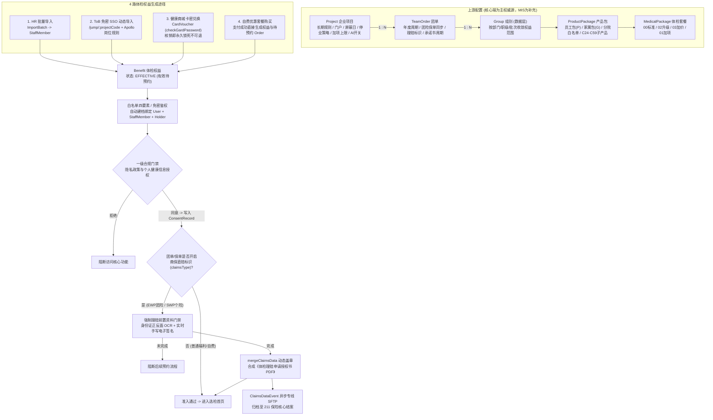
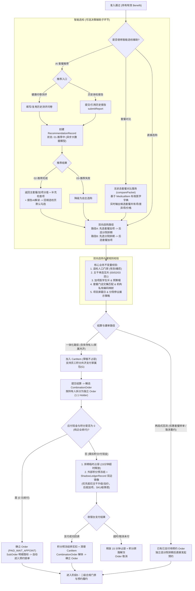
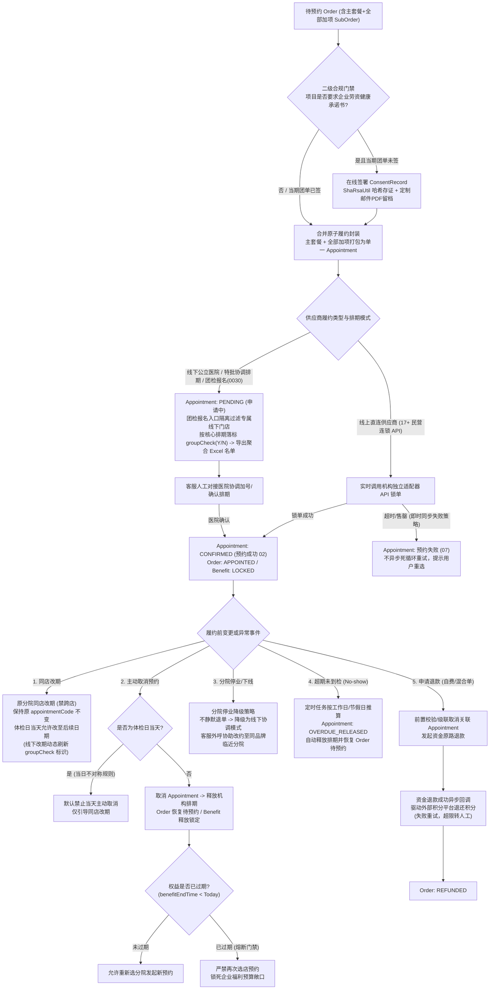
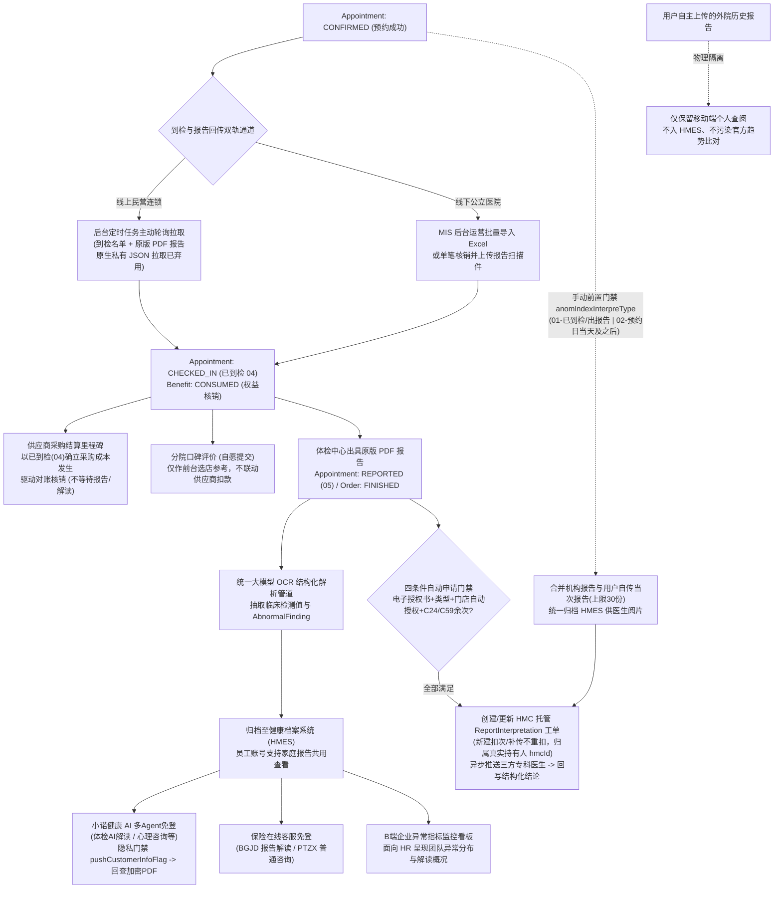
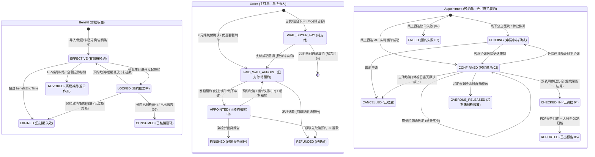

# 体检系统（HMSC）核心领域全景流程图

> 本文档与 [domain-entities.md](file:///D:/coder/代码/体检/docs/domain-entities.md)、[CONTEXT-MAP.md](file:///D:/coder/代码/体检/CONTEXT-MAP.md) 及 [hmsc-service/CONTEXT.md](file:///D:/coder/代码/体检/hmsc-service/CONTEXT.md) 保持完全一致。
>
> **核心建模约定**：
> 1. **单链归属**：`Benefit（体检权益） ➔ Order（主订单，含 0 元统付单） ➔ Appointment（预约单）`。
> 2. **顶层配置层级**：`Project（1，核心端为主权威源、MIS 补充） ➔ TeamOrder（N，年度/批次周期） ➔ Group（数据层二级组别，前台不露出） ➔ ProductPackage（P 员工包 / G 家属包）`。
> 3. **双入口汇流**：同时承接「一体化选检加车结算锁单」与「已支付待预约主订单独立选店/重约」两条路径。

---

## 一、体检业务端到端全景主流程图

```mermaid
flowchart LR
    subgraph S1["阶段1：顶层配置与权益发放"]
        P["Project 企业项目\n(核心端主配置 / MIS补充)"] --> TO["TeamOrder 团单\n(1:N 年度周期/理赔标识)"]
        TO --> GRP["Group 组别\n(数据层部门/批次分组，前台不露出)"]
        GRP --> PP["ProductPackage 产品包\n(P员工 / G家属 + 增值子产品)"]
        E1["HR批量导入 / 免密SSO\n卡密兑换 / 自费优惠购"] --> B["Benefit 体检权益\n(有效期/次数门禁)"]
        PP -.-> B
    end

    subgraph S2["阶段2：鉴权与准入门禁"]
        B --> L["白名单/免密登录\n自动绑定 User/Staff/Holder"]
        L --> G1{"一级合规门禁\n隐私与健康信息授权"}
        G1 -- "已同意" --> G2{"团单开启商保直赔?"}
        G2 -- "是" --> CL["ClaimApplication\n身份证OCR + 手写签名\n合成PDF -> SFTP归档211核心"]
        G2 -- "否" --> SEL_ENTRY["进入体检选购入口"]
        CL --> SEL_ENTRY
    end

    subgraph S3["阶段3：智能选检与双向选购"]
        SEL_ENTRY -. "可选辅助" .-> AI["AI套餐推荐\n(问卷 / 历史报告异步打分)\n& 套餐对比 (标准医学字典)"]
        AI -. "自动勾选/参考" .-> PICK["双向选购与硬校验\n选套餐加项 <-> 选分院排期\n适检/互斥/预算帽/交集匹配"]
        SEL_ENTRY --> PICK
    end

    subgraph S4["阶段4：结算与主订单确立"]
        PICK --> CART["CartItem 加车\n-> CombinationOrder 合并结算"]
        CART --> PAY["积分两阶段冻结(镜像账本)\n+ 现金支付 / 0元统付确认\n+ 15分钟排期临时占容"]
        PAY --> ORD["Order 主订单 (单持有人)\n+ SubOrder 明细落标"]
        REBOOK["已支付待预约 Order\n(优惠转单 / 取消重约回流)"] --> ORD
    end

    subgraph S5["阶段5：预约履约与异常变更"]
        ORD --> G3{"二级合规门禁\n企业劳资健康承诺书"}
        G3 -- "已签署(年度绑定)" --> APT["Appointment 预约单\n(主套餐+加项合并原子交付)"]
        APT --> SUP_ON["线上直连供应商 API\n实时锁单 -> 成功(02)/失败(07)"]
        APT --> SUP_OFF["线下公立医院 / 特批协调\n申请中 -> 人工协调 -> 确认"]
        SUP_ON & SUP_OFF -. "变更/异常" .-> CHG["同店改期 / 取消重约(过期熔断)\n停业降级协调 / 超期释放 / 退款"]
    end

    subgraph S6["阶段6：到检核销、报告与闭环"]
        SUP_ON & SUP_OFF --> CHK["双轨到检同步 (已到检 04)\n确立供应商采购结算里程碑"]
        CHK --> RPT["Report PDF 报告\n大模型OCR解析 -> 归档HMES"]
        RPT --> VAS["小诺AI免登(解读/心理) / C24·C59手动&自动解读\n在线客服(BGJD) / 家庭共用 / HR看板"]
    end

    subgraph S7["并行路径：院外报销与积分变现"]
        B -. "与预约互斥(01)\n或异常复检(02)" .-> REIM_M["MedicalReimbursement\n体检代报销(双抬头/原件寄送)\n全额核准 / 05原单改卡重推"]
        L -. "员工本人健康消费\n三类积分源1:1冻结" .-> REIM_P["PointsReimbursement\n积分报销(仅个人发票)\n打款回调转实扣 / 05保冻重推"]
    end
```

---

## 二、子图 1：上游配置、4 路权益发放与准入门禁流

覆盖 `Project` / `TeamOrder` / `ProductPackage` 配置、4 条权益来源、ToB 免密动态赋权、一级隐私门禁与商保直赔前置门禁（ADR-0011、ADR-0013、ADR-0014）。

---

## 三、子图 2：智能选检、双向选购与两阶段积分结算流

覆盖 **AI 套餐推荐（问卷/报告双入口）**、**套餐对比**、双向交集匹配、购物车合并结算、积分两阶段冻结与双边镜像账本（ADR-0001、ADR-0003、ADR-0004、ADR-0005、ADR-0006、ADR-0009）。

---

## 四、子图 3：预约履约与异常变更流

覆盖二级劳资承诺书门禁、合并原子履约、线上直连 vs 线下协调、原分院同店改期、当日不对称改退、权益过期熔断、分院停业降级、超期未到检自动释放及退款级序（ADR-0002、ADR-0005、ADR-0007、ADR-0008、ADR-0012、ADR-0014）。

---

## 五、子图 4：双轨到检核销、报告解读（手动/自动/小诺AI免登）与对账闭环流

覆盖双轨状态同步、已到检（04）供应商采购结算里程碑、大模型 OCR 统一解析归档 HMES、自主外院历史报告隔离、C24/C59 手动前置开放门禁与四条件自动申请、小诺健康 AI 多 Agent 免登（报告解读/心理咨询 + 隐私门禁）、保险在线客服（`BGJD`）与 HR 异常监控看板（ADR-0008、ADR-0010、ADR-0012、ADR-0016）。

---

## 六、子图 5：`Benefit` / `Order` / `Appointment` 三态联动状态机

明确单链模型下三大核心聚合根的状态演进与跨聚合事件联动。

---

## 七、子图 6：体检代报销与积分报销全景流程

覆盖 `MedicalReimbursement`（体检报销 `01` 与预约互斥、复检报销 `02` 独立共存、支持员工及家属、双抬头发票与 `08-待寄送发票原件`）、`PointsReimbursement`（仅限员工本人、仅个人发票、三类积分源两阶段核销）、全额核准不部分核减以及 `05-付款失败` 原单改卡免复审直推（ADR-0015）。

```mermaid
flowchart TD
    subgraph MED["路径 A：体检代报销 (MedicalReimbursement，支持员工本人与家属)"]
        M_TYPE{"报销类型"}
        M_TYPE -- "01 体检报销" --> M_EX{"权益互斥门禁\n同一权益是否已有预约/有效报销?"}
        M_EX -- "是" --> M_BLK["硬阻断：您已使用体检权益，无法再报销"]
        M_EX -- "否" --> M_SUB["提交个人/公司双抬头发票与体检凭证\n状态: 01-审核中"]
        M_TYPE -- "02 复检报销\n(首次体检异常后)" --> M_REC["校验独立复检权益 (reimburseRecheckCode)\n可与首次体检共存"] --> M_SUB

        M_SUB --> M_ACT{"审核与用户操作"}
        M_ACT -- "用户撤销" --> M_CAN["04-已取消 (终态)"]
        M_ACT -- "需原件核验" --> M_MAIL["08-待寄送发票原件 -> 核验通过"]
        M_ACT -- "审核驳回 (All-or-Nothing)" --> M_REJ["06-审核未通过 (终态，修正后重提)"]
        M_ACT -- "全额审核通过" --> M_WAIT["02-待付款 -> 推送核心财务打款"]
        M_MAIL --> M_WAIT

        M_WAIT --> M_PAY{"核心财务打款回调"}
        M_PAY -- "成功" --> M_DONE["03-已付款 (终态)"]
        M_PAY -- "失败" --> M_FAIL["05-付款失败\n原单号不变，修改银行卡跳过复审直推"]
        M_FAIL --> M_WAIT
    end

    subgraph PTS["路径 B：积分报销 (PointsReimbursement，仅限员工本人个人发票)"]
        P_SUB["提交个人健康消费发票\n(单项体检/疫苗/牙科/眼科/健身瑜伽，无原件寄送)"] --> P_FRZ["按 1:1 预冻结积分\n(核心 / 薪福通 / 福粒三类积分源)\n状态: 01-审核中"]
        P_FRZ --> P_ACT{"审核与用户操作"}
        P_ACT -- "用户撤销 / 全额驳回" --> P_REL["04-已取消 / 06-审核未通过\n驱动积分原路解冻返还 (终态)"]
        P_ACT -- "全额审核通过\n(不支持部分核减)" --> P_WAIT["02-待付款 -> 推送核心财务打款"]

        P_WAIT --> P_PAY{"核心财务打款回调"}
        P_PAY -- "成功" --> P_DONE["03-已付款\n驱动冻结积分转实扣 (终态)"]
        P_PAY -- "失败" --> P_FAIL["05-付款失败\n保持积分冻结不退回，原单改卡跳过复审直推"]
        P_FAIL --> P_WAIT
    end
```

