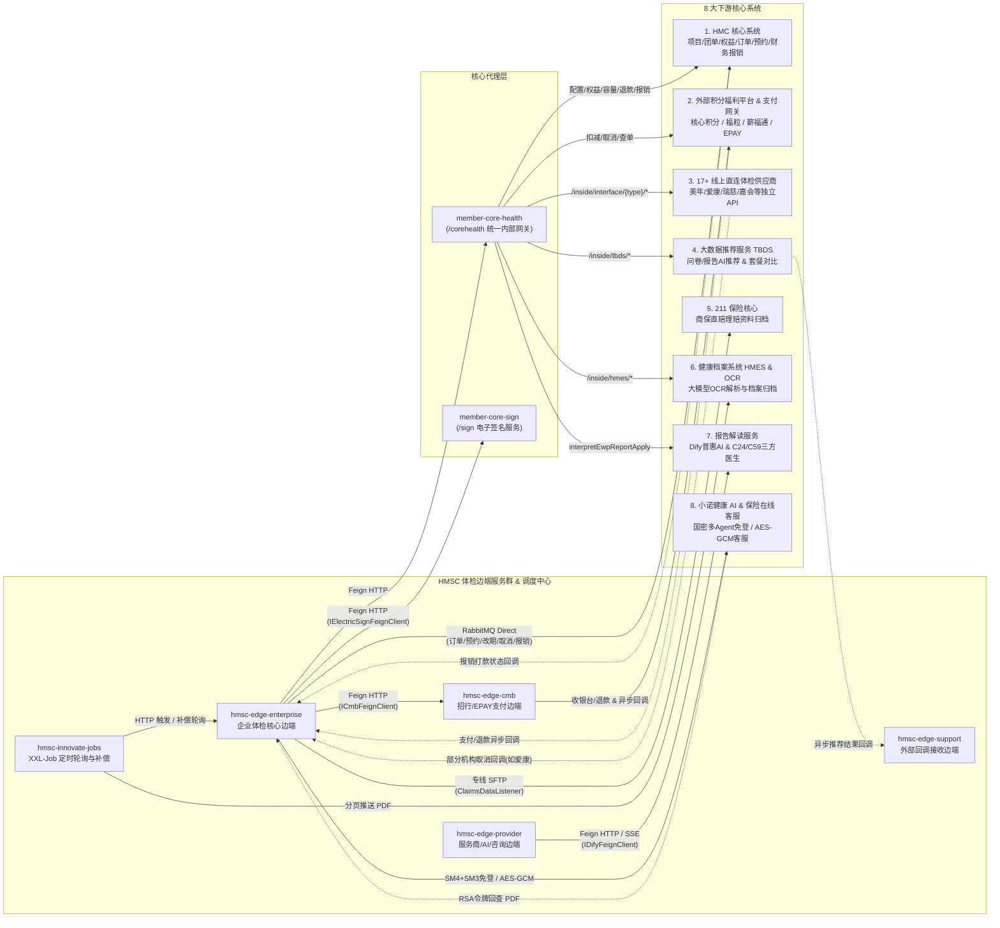
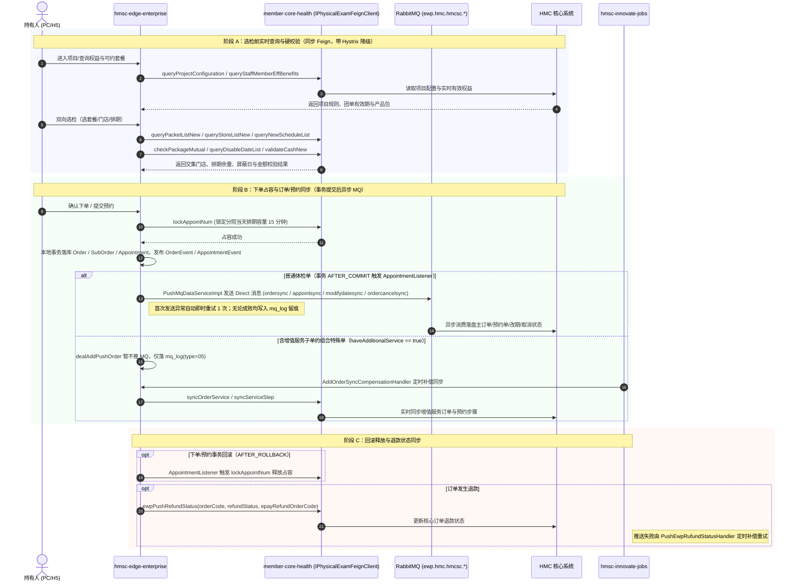
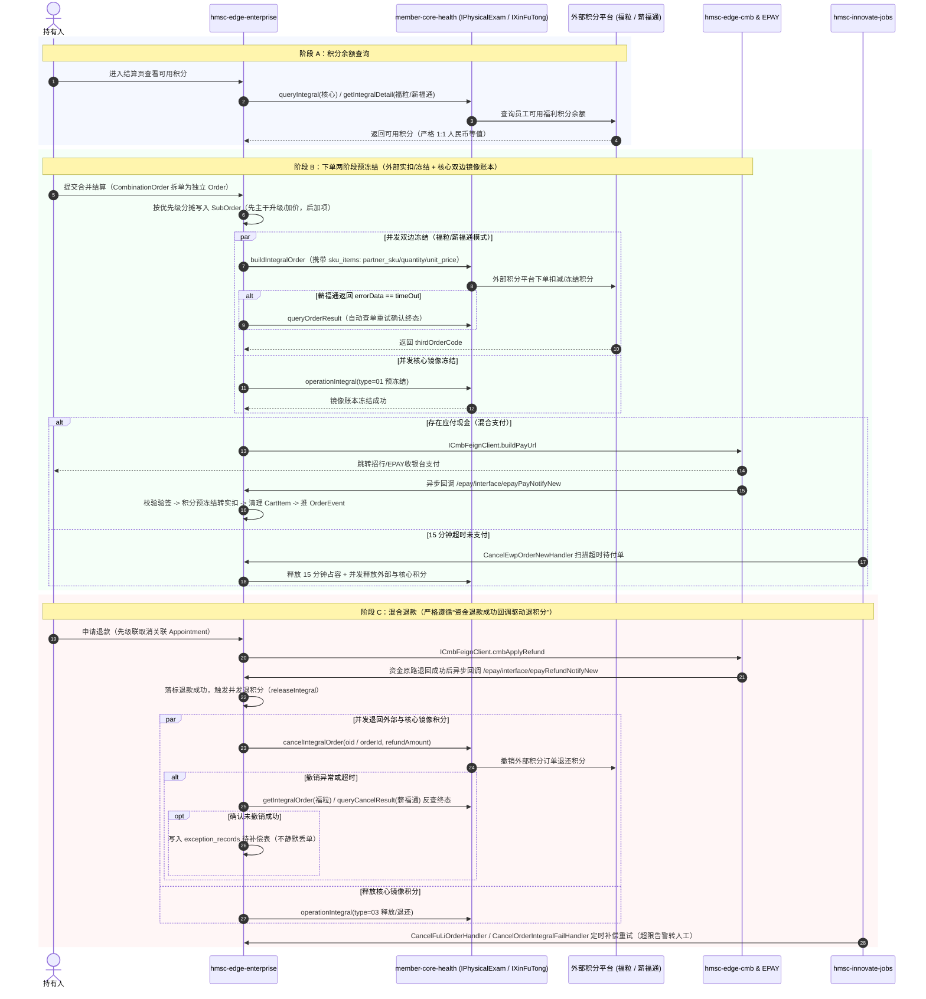
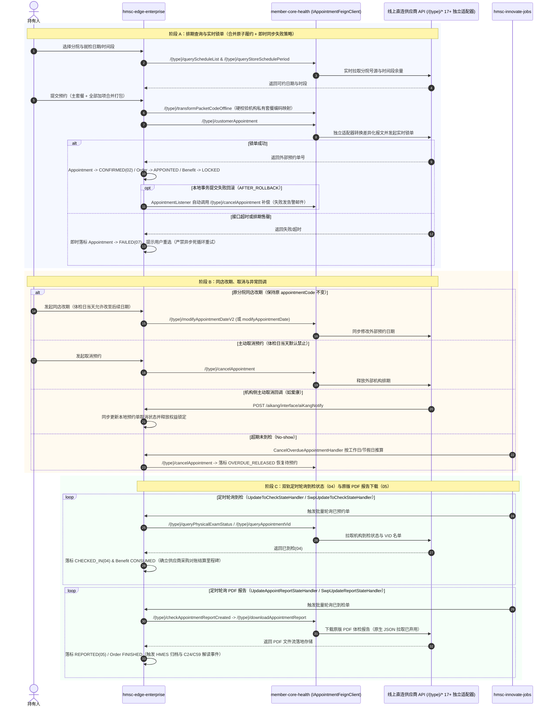
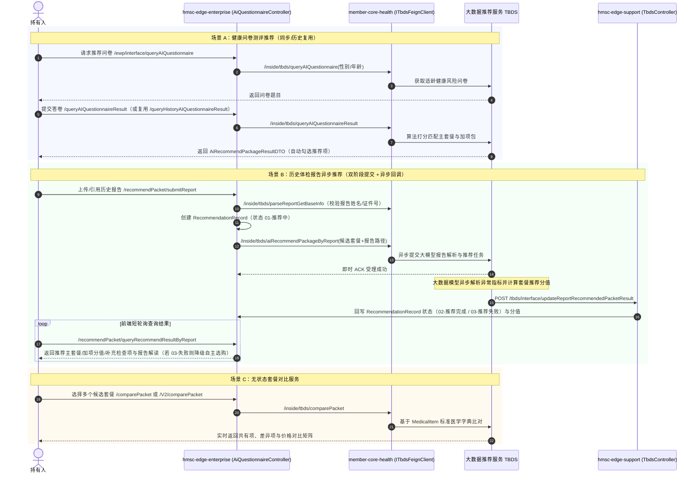
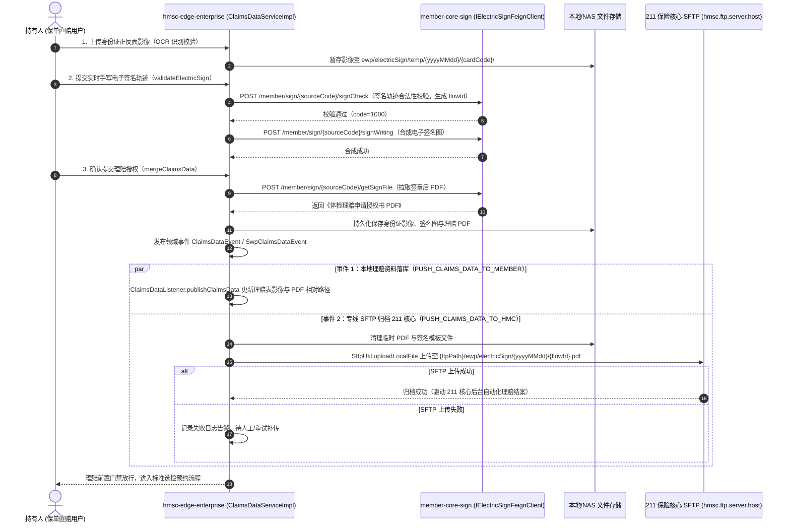
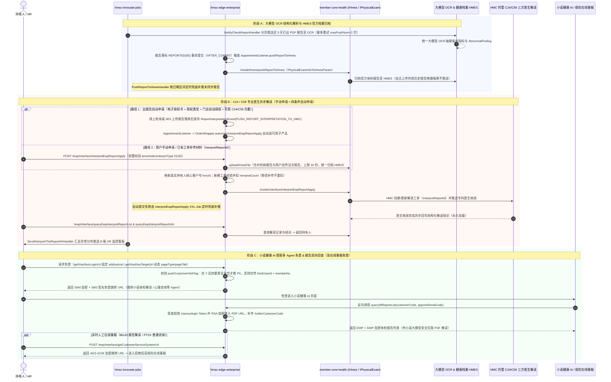
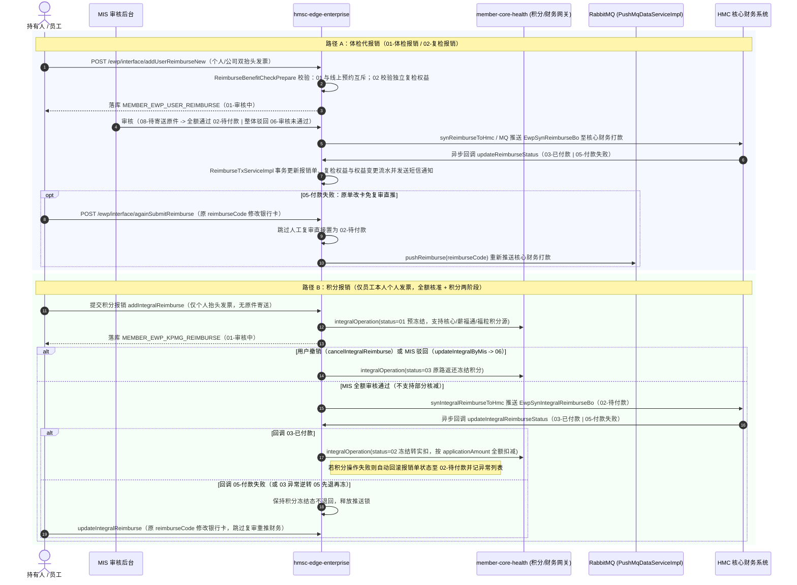

# 体检系统（HMSC）下游核心接口与系统集成时序图

> 本文档为体检领域全景的**系统集成层**配套文档，与纯业务语义的 [domain-flows.md](file:///D:/coder/代码/体检/docs/domain-flows.md)、[domain-entities.md](file:///D:/coder/代码/体检/docs/domain-entities.md)、[CONTEXT-MAP.md](file:///D:/coder/代码/体检/CONTEXT-MAP.md) 及 [hmsc-service/CONTEXT.md](file:///D:/coder/代码/体检/hmsc-service/CONTEXT.md) 保持严格分层与术语一致。
>
> **分层约定**：业务流程图不暴露具体 URL、Feign 客户端、MQ 队列或 SFTP 路径；所有跨系统接口契约、同步/异步通道、重试与降级策略均收敛于本文档。

---

## 一、下游系统集成全景拓扑

HMSC 边端微服务群（`hmsc-edge-enterprise` / `hmsc-edge-provider` / `hmsc-edge-cmb` / `hmsc-edge-support` / `hmsc-edge-ehr`）与调度中心（`hmsc-innovate-jobs` XXL-Job）通过 **核心中台网关（`member-core-health`）**、**RabbitMQ**、**专线 SFTP** 及 **国密/加密免登网关** 协同 8 大下游系统：

---

## 二、时序图 1：HMC 核心系统同步链路（配置/权益/占容 + MQ 异步同步）

覆盖项目/权益/门店排期实时查询、15 分钟排期占容与释放、以及主订单/预约单/改期/取消经由 RabbitMQ 异步同步至 HMC 核心（含“体检 + 增值服务”组合特殊单延迟同步与退款状态回推）。

---

## 三、时序图 2：外部积分福利平台 & 支付网关两阶段结算与回调退积分链路

覆盖 **核心积分（`CoreIntegralServiceImpl`）**、**福粒平台（`FuLiIntegralServiceImpl`）**、**薪福通（`XinFuTongIntegralServiceImpl`）** 的双边镜像账本、SKU 级穿透扣减、超时查单、15 分钟未付自动释放，以及 **资金退款成功异步回调驱动退积分** 的事务级序（ADR-0004、ADR-0005、ADR-0006）。

---

## 四、时序图 3：17+ 线上直连体检供应商全生命周期链路

覆盖通过 `IAppointmentFeignClient`（`/inside/interface/{type}/*`）对接 17+ 民营体检连锁（爱康、美年、瑞慈、慈铭、嘉会、中科等）的排期查询、实时锁单（即时同步失败策略 `07`）、同店改期/取消、部分机构主动回调，以及 XXL-Job 定时轮询到检（`04` 采购结算里程碑）与原版 PDF 报告下载（ADR-0007、ADR-0008、ADR-0012）。

---

## 五、时序图 4：大数据推荐服务 TBDS（智能选检异步推荐 & 套餐对比）

覆盖问卷推荐、历史体检报告异步推荐（`RecommendationRecord`：`01-推荐中` ➔ `02-推荐完成` / `03-推荐失败`）以及基于标准医学字典的无状态套餐对比（`AiQuestionnaireController`、`ITbdsFeignClient`、`TbdsController`）。

---

## 六、时序图 5：211 保险核心商保直赔与电子签名 SFTP 归档链路

覆盖开启商保直赔标识（EWP 团险 / SWP 散客）的前置资料门禁、电子签名校验与 PDF 动态盖章合成（`IElectricSignFeignClient`、`ClaimsDataServiceImpl`），以及事件驱动专线 SFTP 归档至 211 保险核心结案（`ClaimsDataEvent` / `SwpClaimsDataEvent`、`ClaimsDataListener`、ADR-0013）。

---

## 七、时序图 6：报告 OCR 归档 HMES、C24/C59 手动与自动解读、小诺健康 AI 免登及在线客服链路

覆盖原版 PDF 报告经大模型 OCR 统一解析归档 HMES、C24/C59 手动前置开放门禁与四条件自动申请报告解读（`ReportInterpretationEvent`）、外部小诺健康 AI 国密免登与 RSA 短效令牌双向回查报告（`queryAllReportList`），以及保险在线客服 AES-GCM 免登（ADR-0010、ADR-0016）。

---

## 八、时序图 7：体检代报销与积分报销核心财务推送、回调及原单改卡重推链路

覆盖 `MedicalReimbursement`（`MengniuController` / `IMengniuServiceImpl` / `ReimburseTxServiceImpl`）与 `PointsReimbursement`（`KpmgServiceImpl`）的权益互斥校验、三类积分源冻结、MIS 全额审核推送核心财务、异步打款回调与 `05-付款失败` 原单改卡免复审直推（ADR-0015）。

---

## 九、下游核心接口契约总表（Interface Contract Matrix）

| 下游系统 | 调用方 / 接收方 | 协议与客户端 / 入口 | 核心接口 / Topic / 路径 | 通信模式 | 失败重试与降级策略 |
| :--- | :--- | :--- | :--- | :--- | :--- |
| **1. HMC 核心系统** | `hmsc-edge-enterprise` ➔ `member-core-health` | Feign HTTP (`IPhysicalExamFeignClient`) | `queryProjectConfiguration`、`queryStaffMemberEffBenefits`、`queryPackageListNew`、`queryStoreListNew`、`queryNewScheduleList`、`validateCashNew`、`lockAppointNum`、`ewpPushRefundStatus` | 同步 | `PhysicalExamHystrix` 降级兜底；事务回滚监听自动释放占容；退款推送失败由 `PushEwpRufundStatusHandler` 定时补偿 |
| **1. HMC 核心系统** | `hmsc-edge-enterprise` ➔ HMC | RabbitMQ Direct (`PushMqDataServiceImpl` / `MqProperties`) | `ordersync`、`appointsync`、`modifydatesync`、`ordercancelsync` | 异步（事务 `AFTER_COMMIT`） | 首次发送失败即时重试 1 次并落 `mq_log`；含增值服务特殊单走 `mq_log(type=05)` + `AddOrderSyncCompensationHandler` 补偿 |
| **2. 外部积分福利平台** | `hmsc-edge-enterprise` ➔ `member-core-health` | Feign HTTP (`IPhysicalExamFeignClient` / `IXinFuTongFeignClient`) | 核心：`queryIntegral` / `operationIntegral` 福粒：`getIntegralDetail` / `buildIntegralOrder` / `cancelIntegralOrder` / `getIntegralOrder` 薪福通：`getIntegralDetail` / `buildIntegralOrder` / `queryOrderResult` / `cancelIntegralOrder` / `queryCancelResult` | 同步（双边并发） | 薪福通下单超时自动调 `queryOrderResult` 重试查单；退积分失败先反查终态，确认未撤则落 `exception_records`，由 `CancelFuLiOrderHandler` / `CancelOrderIntegralFailHandler` 定时补偿，超限转人工 |
| **2. 支付网关 (CMB/EPAY)** | `hmsc-edge-enterprise` ⇄ `hmsc-edge-cmb` / EPAY | Feign HTTP (`ICmbFeignClient`) + HTTP 回调 (`NotifyNewController`) | 出站：`buildPayUrl`、`cmbApplyRefund`、`queryCmbRefundInfo` 入站：`/epay/interface/epayPayNotifyNew`、`/epay/interface/epayRefundNotifyNew` | 同步建单 + 异步回调 | 支付回调验签幂等；退款回调驱动退积分（异常返回 `FAIL` 触发支付平台重试）；超时未付由 `CancelEwpOrderNewHandler` 15 分钟释放 |
| **3. 17+ 线上直连供应商** | `hmsc-edge-enterprise` ➔ `member-core-health` | Feign HTTP (`IAppointmentFeignClient`, `/inside/interface/{type}/*`) | 实时：`queryScheduleList`、`queryStoreSchedulePeriod`、`transformPacketCodeOffline`、`customerAppointment`、`modifyAppointmentDateV2`、`cancelAppointment` 轮询：`queryPhysicalExamStatus`、`queryAppointmentVid`、`checkAppointmentReportCreated`、`downloadAppointmentReport` 入站回调：`/aikang/interface/aiKangNotify` | 同步锁单 + XXL-Job 定时轮询 | **即时同步失败策略**：锁单超时/售罄直接落标 `07`，不异步重试；本地事务回滚自动调 `cancelAppointment` 补偿（失败发邮件告警）；到检/报告由 `UpdateToCheckStateHandler` / `UpdateAppointReportStateHandler` 周期轮询；原生 JSON 拉取已弃用 |
| **4. 大数据推荐 TBDS** | `hmsc-edge-enterprise` ➔ `member-core-health`；TBDS ➔ `hmsc-edge-support` | Feign HTTP (`ITbdsFeignClient`, `/inside/tbds/*`) + HTTP 回调 (`TbdsController`) | 出站：`queryAIQuestionnaire`、`queryAIQuestionnaireResult`、`parseReportGetBaseInfo`、`aiRecommendPackageByReport`、`comparePacket` 入站：`/tbds/interface/updateReportRecommendedPacketResult` | 同步（问卷/对比）+ 异步回调（报告推荐） | `TbdsHystrix` 降级；报告推荐任务失败落标 `03-推荐失败`，前端平滑降级为自主选购，不阻断主履约链路 |
| **5. 电子签名 & 211 保险核心** | `hmsc-edge-enterprise` ➔ `member-core-sign` & 211 SFTP | Feign HTTP (`IElectricSignFeignClient`) + 专线 SFTP (`ClaimsDataListener`) | 签名：`/member/sign/{sourceCode}/signCheck`、`signWriting`、`getSignFile` 归档：`SftpUtil.uploadLocalFile` ➔ `{ftpPath}/ewp/electricSign/{yyyyMMdd}/{flowId}.pdf` | 同步签章 + 事件驱动异步 SFTP | 签章失败硬阻断理赔前置门禁；PDF 合成后双事件解耦本地落库与 SFTP 归档，SFTP 异常记录日志告警补传 |
| **6. 健康档案 HMES & 大模型 OCR** | `hmsc-edge-enterprise` / `hmsc-innovate-jobs` ➔ `member-core-health` | Feign HTTP (`IHmesFeignClient`, `/inside/hmes/*`) + XXL-Job | `pushReportToHmes`、`queryReportJsonList`、`queryMedicalSubjectList`；`NotifyCheckReportHandler` 分页推 OCR | 事件异步 + XXL-Job 补偿 | OCR 推送最大重试 `maxPushNum=2`；`PushReportToHmesHandler` 支持按时间区间手动/定时补推；自主外院报告物理隔离不入 HMES |
| **7. 报告解读（Dify AI & C24/C59 医生）** | `hmsc-edge-provider` ➔ Dify；`hmsc-edge-enterprise` ➔ `member-core-health` | Feign HTTP/SSE (`IDifyFeignClient`) + Feign HTTP (`IPhysicalExamFeignClient`) | Dify：`/v1/workflows/run`、`/v1/chat-messages` (SSE) 医生解读：`interpretEwpReportApply`、`uploadHmesFile`、`queryEwpInterpretReportInfo`、`queryEwpInterpretReportList` | 同步/流式（AI）+ 异步工单（医生） | AI 解读独立于人工服务；C24/C59 支持手动前置门禁与四条件 `ReportInterpretationEvent` 自动触发，自动提交失败由 `InterpretEwpReportApply` XXL-Job 兜底补推 |
| **8. 小诺健康 AI & 保险在线客服** | `hmsc-edge-enterprise` ⇄ 小诺健康 AI / 保险在线客服 | 国密 SM4+SM3 免登 + HTTP 回调；AES-GCM 加密跳转 | 出站：`getXiaoNuoLoginUrl`（固定 `ai/physical`）、`getXiaoNuoTargetUrl`（多 Agent `pageType/pageTab`）、`getCustomerServiceSystemUrl`（`BGJD/PTZX`） 入站回查：`queryAllReportList`（RSA 加密 `xiaonuologin` Token） | 免登跳转 + 反向加密拉取 | `pushCustomerInfoFlag` 四要素原子隐私门禁（缺一不推 PII）；短效 RSA 令牌控权防报告裸奔 |
| **1. HMC 核心财务（报销打款）** | `hmsc-edge-enterprise` ⇄ HMC 核心财务 | HTTP / RabbitMQ (`PushMqDataServiceImpl`) + 异步回调 | 推送：`synReimburseToHmc`、`synIntegralReimburseToHmc`、`pushReimburse` 回调：`updateReimburseStatus`、`updateIntegralReimburseStatus`、`updateIntegralByMis` | 异步推送 + 回调驱动 | 全额核准不部分核减；积分报销回调 `03` 转实扣失败自动回滚至 `02`；`05-付款失败` 维持冻结态，原单改卡免复审直推 |
