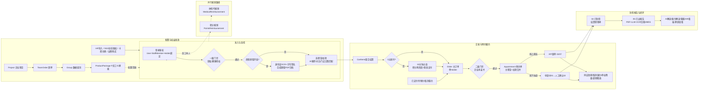
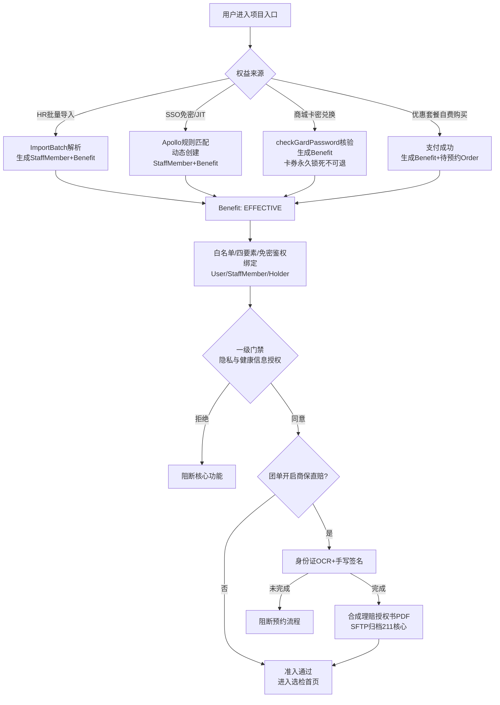
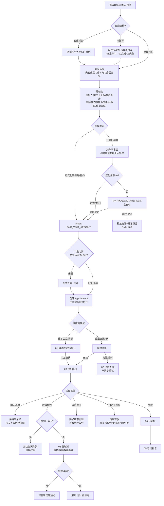
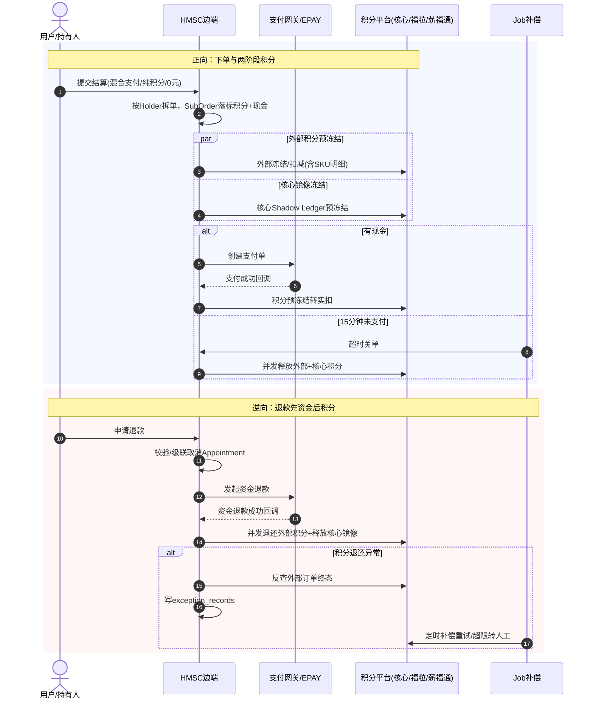
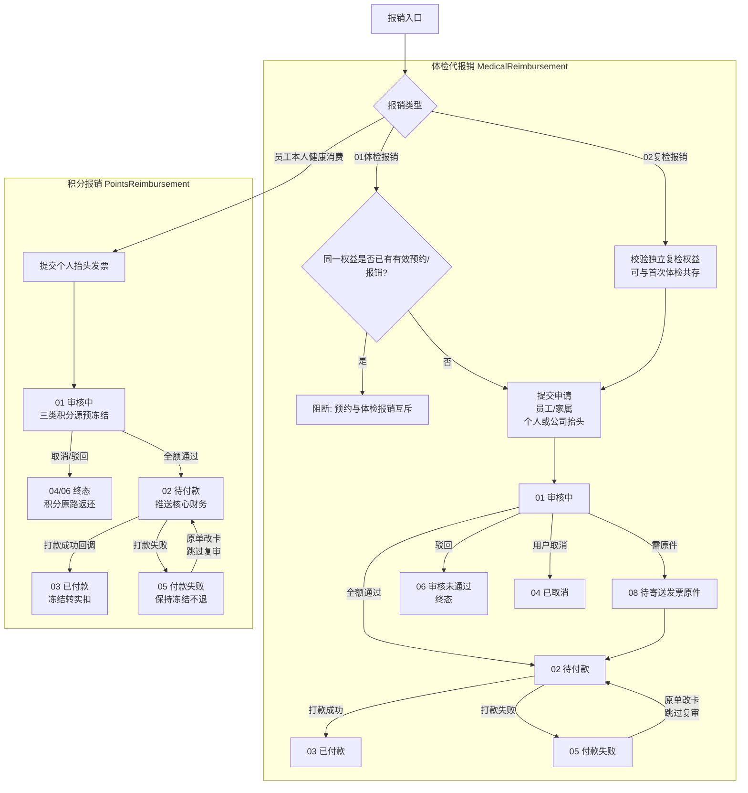
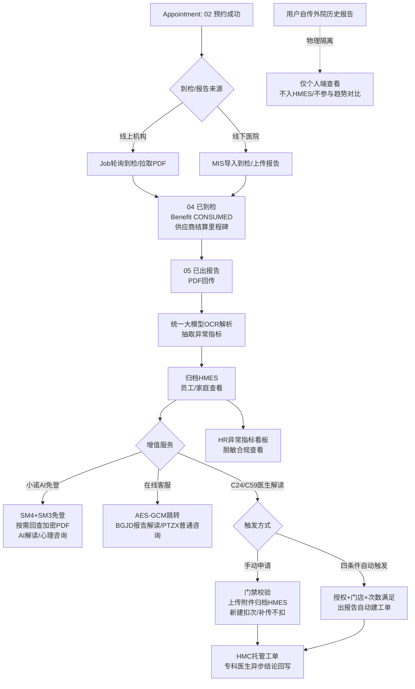
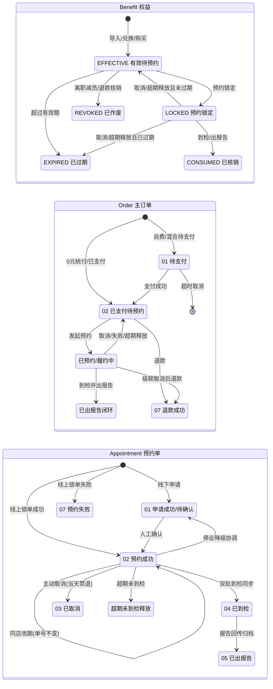

# 体检业务统一语言与核心流程图

> **文档定位**：面向**产品经理（PM）**与**高级开发**的统一沟通基线。  
> **整理依据**：`domain-entities.md`、`domain-flows.md`、`frontend-flows.md`、`integration-flows.md` 及 ADR-0001 ~ ADR-0016。  
> **使用方式**：需求评审、方案设计、联调对齐、埋点/状态机/接口契约评审时，以本文术语与流程为默认口径；如与代码冲突，以代码+ADR 为准并回写本文。

---

## 阅读指南

| 视角 | 重点关注 | 怎么用 |
|---|---|---|
| **产品经理（PM）** | 术语定义、业务边界、用户可见流程、状态文案、异常分支 | 用于 PRD 撰写、验收标准、跨团队沟通，避免同词不同义 |
| **高级开发** | 聚合边界、不变量、状态机、联动时序、失败补偿、系统集成 | 用于领域建模、接口契约、状态流转、幂等/补偿/门禁实现 |

**核心建模约定（全篇通用）**：

1. **单链归属**：`Benefit（体检权益） ➔ Order（主订单，含 0 元统付单） ➔ Appointment（预约单）`。
2. **顶层配置层级**：`Project（1） ➔ TeamOrder（N） ➔ Group（数据层，前台不露出） ➔ ProductPackage（P 员工包 / G 家属包）`。
3. **双入口汇流**：支持“一体化选检加车结算锁单”与“已支付待预约主订单独立选店/重约”两条路径。
4. **一码一义**：主订单状态与预约单状态**两套独立码值且存在重号**（如 `01`），判断时必须明确维度。

---

## 一、统一语言（Ubiquitous Language）· 核心域名词表

> 说明：**定义（PM）**回答“这是什么、给谁用、业务上代表什么”；**关键规则/不变量（Dev）**回答“系统必须如何约束、状态如何流转、边界在哪里”。

### 1.1 顶层配置与权益准入域

| 术语（中/英） | 定义（PM 视角） | 关键规则 / 不变量（Dev 视角） | 别名 / 易混淆 | 来源 |
|---|---|---|---|---|
| **企业项目 Project** | 企业客户在平台的顶层配置根，承载长期规则、门户入口、项目级开关与产品目录。 | `projectCode/projectId` 唯一；核心端为主权威源，MIS 为补充；与 TeamOrder 为 1:N；承载屏蔽日、停业策略、排期时段开关、AI 开关、加项预算帽等项目级配置。 | 不等于团单；项目是长期容器，团单是年度/批次实例 | domain-entities#12 |
| **团单 TeamOrder** | 项目下某一年度/批次的合同与福利周期实例，决定当期权益有效期与合规周期。 | `teamOrderCode` 唯一；归属 Project；承载权益起止期、商保理赔标识（`claimsType`）、承诺书年度周期；可由团险核心同步 EWP 保单团单。 | 不等于订单 Order | domain-entities#13, ADR-0013 |
| **组别 Group** | 团单下的数据分组，用于按部门/职级/批次配置差异化权益范围。 | `(projectCode, teamOrderCode, groupCode)` 唯一；属 TeamOrder 内部配置实体；同一团单下员工可归属多个组别（M:N）；**前台文案不露出“组别”**。 | 仅数据层概念，不是前台筛选标签 | domain-entities#2a |
| **产品包 ProductPackage** | 企业维度的权益集合容器，圈定可选套餐、分院、增值子产品与统付范围。 | `packageCode/packageId` 唯一；区分员工专属 `P` 与家属 `G`；挂载 MedicalPackage、SubProduct、分院白名单。 | 也叫“权益包”；不等于 MedicalPackage | domain-entities#6, ADR-0009 |
| **体检套餐 MedicalPackage** | 具体临床体检科目组合，是用户实际选择的体检方案。 | `packetCode/packetId` 唯一；类型：`00` 标准主套餐、`01` 自选加项包、`02` 升级套餐、`03` 加价套餐；主干套餐单选互斥（00/02/03 选 1）。 | “套餐”默认指 MedicalPackage；加项包也是一种套餐类型 | domain-entities#7, ADR-0009 |
| **增值子产品 SubProduct** | 挂载在产品包下的增值服务权益，如 C24/C59 医生解读。 | `productCode/productId` 唯一；随权益/产品包导入赋权，**不在商城零售上架**；消费时按次核销。 | C24/C59 是典型子产品 | domain-entities#8, ADR-0010, ADR-0011 |
| **临床体检项目 MedicalItem** | 平台统一标准医学科目，用于跨机构映射、互斥校验、套餐对比。 | `itemId/itemCode` 唯一；标准医学字典；供应商私有项目必须映射到标准项目；适检性别/婚否门禁依赖该层。 | 不等于套餐；是套餐的组成项 | domain-entities#9, ADR-0009, ADR-0012 |
| **名单导入批次 ImportBatch** | HR 批量导入名单的处理批次凭据，用于审计与追踪。 | `batchSerialNo/importSerialNumber` 唯一；状态 `PARSING/PROCESSING/COMPLETED/FAILED`；记录总数/失败数；成功后级联生成 StaffMember 与 Benefit。 | 批次不是人员，不是权益 | domain-entities#1 |
| **企业名单员工 StaffMember** | 企业导入的白名单人员，是 B2B 鉴权、建档、权益发放的主体依据。 | `customerCode` 或 `(projectCode + workCode/idno)` 唯一；承载四要素、在职状态、人员类型（员工/家属）、亲属关系；离职可触发权益冻结/作废。 | “白名单人员”；不等于 User 登录账号 | domain-entities#2 |
| **用户账号 User** | 平台登录主账号，负责登录、统一出资、家庭报告聚合查看。 | `userId` 唯一；可绑定多个 StaffMember/Holder 场景；员工账号可查看家属报告。 | 购买人/登录人；不等于实际体检人 Holder | domain-entities#25 |
| **体检权益 Benefit / Equity** | 持有人可用于体检的资格凭据，是预约与下单的前置门禁。 | `importSerialNumber/equityId` 唯一；状态 `EFFECTIVE/LOCKED/CONSUMED/EXPIRED/REVOKED`；发起预约前校验有效期与可用次数；预约锁定、取消/超期释放、到检核销；**权益过期后禁止再次选店新预约**。 | 也叫“权益”；前台常叫“体检资格/体检权益” | domain-entities#3, ADR-0008 |
| **持有人 Holder** | 实际执行体检的自然人。 | `holderId`（证件类型+证件号）唯一；**一笔主订单严格绑定单一 Holder（1:1）**；多持有人下单需拆单。 | 前台常叫“体检人” | domain-entities#13, ADR-0001 |
| **合规签署记录 ConsentRecord** | 用户签署隐私授权或企业承诺书的法律存证。 | `consentId` 或 `(customerCode+projectCode+teamOrderCode)` 唯一；一级门禁：隐私/健康信息授权；二级门禁：企业劳资健康承诺书，未签阻断预约提交；签署绑定年度团单周期，跨年重签。 | 含隐私协议、承诺书 | domain-entities#24, ADR-0014 |

### 1.2 选检、下单与交易域

| 术语（中/英） | 定义（PM 视角） | 关键规则 / 不变量（Dev 视角） | 别名 / 易混淆 | 来源 |
|---|---|---|---|---|
| **智能推荐记录 RecommendationRecord** | AI 根据问卷或历史报告给出的套餐/加项推荐结果记录。 | `reportRequestId` 唯一；状态 `01-推荐中/02-推荐完成/03-推荐失败`；失败降级为自主选购，不阻断主链路；输出主套餐、加项、补充检查项、报告解读结论。 | “AI 推荐”；不是订单 | domain-entities#14, ADR-0009 |
| **套餐对比 Compare Packet** | 用户对多个候选套餐进行项目、价格、差异项对比的决策辅助能力。 | 无状态领域服务，基于 MedicalItem 标准字典实时计算；不单建实体；支持“仅看差异项”。 | 不是 RecommendationRecord | domain-entities#14, frontend-flows#2.5 |
| **购物车项 CartItem** | 用户加车的体检意向草稿。 | `cartItemId` 唯一；加车不占排期容量；仅支付成功回调后物理清理；15 分钟未支付取消后可回退购物车。 | 草稿，不是订单 | domain-entities#19, ADR-0003 |
| **组合订单 CombinationOrder** | 多个购物车项合并结算时的临时收银凭据。 | `combinationOrderId` 唯一；**瞬态聚合根**，仅用于合并扣款/调起支付；支付成功后立即解体；不承担履约、售后、退款主职责。 | 不等于主订单；用户端不应长期展示 | domain-entities#20, ADR-0003 |
| **主订单 Order** | 承接权益、交易结算与履约状态的核心凭据。 | `orderId/mainOrderCode` 唯一；**单持有人 1:1**；含 0 元统付单；状态含 `01待支付/02已支付/05已取消/06退款中/07退款成功/08退款失败/09待审核/10审核通过` 等；支付成功后与权益锁定、预约流转联动。 | 订单 `01` ≠ 预约 `01` | domain-entities#11, ADR-0001 |
| **子订单 SubOrder** | 主订单下的费用与套餐明细单元。 | `subOrderId` 唯一；区分统付/自费、主套餐/加项/升级；承载 `scoreValue`（积分）与 `payCurrencyValue`（现金）精细落标；是退款、发票、对账的原子依据。 | 不是独立履约单 | domain-entities#12, ADR-0004 |
| **积分抵扣 Point Deduction** | 使用企业福利积分支付体检费用的结算能力。 | **1 积分 = 1 元人民币**固定等值；支持 100% 积分抵扣（项目允许时）；抵扣优先级：先主干升级/加价差额，后自选加项；积分值落标到 SubOrder。 | “积分支付/积分抵扣” | ADR-0004 |
| **积分两阶段核销 Two-Phase Point Settlement** | 积分从冻结到实扣/释放的事务控制机制。 | 正向：预冻结 ➔ 支付成功转实扣；取消待付：原路释放；退款：**资金退款成功回调驱动退积分**；失败重试，超限转人工。 | 不可与现金退款并发无序执行 | ADR-0005, ADR-0006 |
| **双边镜像账本 Shadow Ledger** | 外部积分平台与核心本地并发冻结的对账与防超扣机制。 | 外部平台真实扣减/冻结 + 核心本地镜像冻结并发执行；SKU 级明细穿透（`partner_sku/quantity/unit_price`）；逆向并行释放；异常落 `exception_records` 补偿。 | 防超扣、对账审计 | domain-entities#22, ADR-0006 |
| **排期容量 Schedule Capacity** | 某分院某日/某时段可预约余量。 | `remainderVolume` 展示受项目开关控制；下单时触发 15 分钟临时占容（Capacity Hold）；未支付超时释放；与日历状态 `Aboutt`（已约满）相关。 | 容量展示 ≠ 临时占座 | frontend-flows#3.3, ADR-0007 |
| **排期时间段 Schedule Period** | 分院可选的细分时段，如 08:00-09:00。 | 需同时满足：门店/供应商支持时段 + 项目 `appointPeriodSwitch` 开启；否则降级为全天不细分。 | 值对象，无独立生命周期 | frontend-flows#4, ADR-0007 |
| **项目屏蔽日 Blackout Dates** | 项目维度不可预约的日期。 | 企业项目配置；命中日期统一不可选；与 `RestDay/Notopen/Aboutt` 成因不同，不可混用。 | 不是分院公休日 | ADR-0007, frontend-flows#3.3 |

### 1.3 预约履约与变更域

| 术语（中/英） | 定义（PM 视角） | 关键规则 / 不变量（Dev 视角） | 别名 / 易混淆 | 来源 |
|---|---|---|---|---|
| **预约单 Appointment** | 持有人锁定分院与档期的履约凭据，是到检、报告、结算的核心单据。 | `appointmentId/appointmentCode` 唯一；依附 Order；状态 `01申请成功/02预约成功/03取消预约/04已到检/05已出报告/06预约中/07预约失败/08改期中/09取消中`；主套餐+加项合并原子履约。 | 预约 `01`=申请成功（线下待确认），非“受理中”泛称 | domain-entities#14, ADR-0008 |
| **合并原子履约 Bundled Fulfillment** | 主套餐与所有加项在同一分院、同一次预约中一站式完成。 | 一个 Appointment 承载主套餐+全部加项；线上 API 打包推送同一外部单；线下导出聚合为单条记录；不拆散履约。 | 加项不是独立预约 | ADR-0008 |
| **同店改期 Same-Store Reschedule** | 在原分院范围内修改就检日期/时段。 | 保持原 `appointmentCode` 不变；**禁止跨店改期**；体检日当天允许改至后续日期；线下改期动态刷新 `groupCheck` 标识。 | 改期 ≠ 换店 | ADR-0007 |
| **当日不对称改退 Day-of Asymmetry** | 体检当天的取消与改期规则不同。 | **体检日当天默认禁止主动取消**，仅引导同店改期；改期允许延后。 | 防止机构资源空置 | ADR-0007 |
| **权益过期换店熔断 Equity Expiry Guard** | 权益过期后阻断重新预约，防止福利预算敞口扩大。 | 取消预约可执行，但若 `benefitEndTime < Today`，**严禁再次选店发起新预约**；取消前必须明确提示风险。 | “取消后不能再约”场景 | ADR-0008 |
| **超期未到检释放 Overdue No-show Release** | 用户未到检且未取消时，系统自动释放预约。 | 定时任务按工作日/节假日推算；Appointment 置为 `OVERDUE_RELEASED`；释放排期，占用权益恢复为可重新预约（若未过期）。 | 不是用户主动取消 | ADR-0007 |
| **分院停业降级 Store Suspension Downgrade** | 分院临时停业时对在途预约的保护策略。 | 不批量自动退单/作废；降级为线下协调模式；客服外呼协助改约至同品牌临近分院；前台按项目策略隐藏或置灰。 | 容灾体验策略 | ADR-0012 |
| **线上直连供应商 Online Direct Supplier** | 通过 API 实时对接的民营体检连锁。 | 独立 API 直连（无聚合中介）；实时锁单、改期、取消、查状态、拉报告；锁单失败采用**即时同步落标 `07`**，不异步死循环重试。 | 爱康/美年/瑞慈/慈铭/嘉会/中科等 | ADR-0012 |
| **线下公立医院 Offline Public Hospital** | 无法 API 实时锁单、需人工协调的机构。 | 预约进入 `01-申请成功/待确认`；客服/运营人工协调；MIS 导入到检与报告；支持特批协调排期。 | “线下协调模式” | domain-flows#3, ADR-0007 |
| **已到检 Check-in (04)** | 用户实际到分院完成签到/核销。 | Appointment 置 `04`；Benefit 置 `CONSUMED`；**供应商采购结算里程碑**以 `04` 为准，不等待报告/解读。 | 结算基准点 | ADR-0008, ADR-0012 |

### 1.4 报告、解读与增值服务域

| 术语（中/英） | 定义（PM 视角） | 关键规则 / 不变量（Dev 视角） | 别名 / 易混淆 | 来源 |
|---|---|---|---|---|
| **体检报告 Report** | 到检后的总检成果与 PDF 文件，是体检履约终态交付物。 | `reportId` 唯一；来源：线上轮询拉取/线下 MIS 导入；PDF 统一经大模型 OCR 解析抽取指标；归档 HMES。 | 官方报告 | domain-entities#17, ADR-0010 |
| **异常指标 AbnormalFinding** | 报告中偏离参考范围的结构化指标项。 | 值对象；挂载 Report；含指标名、检测值、参考区间、偏高/偏低；供 AI 解读、HR 看板使用。 | 不是独立聚合根 | domain-entities#三 |
| **大模型 OCR 归档 LLM-OCR Ingestion** | 将 PDF 报告统一解析为结构化指标并入档。 | 统一收敛 PDF + 大模型 OCR；**原生私有 JSON 拉取全面弃用**；抽取结果映射标准医学字典并归档 HMES。 | 报告结构化管道 | ADR-0010 |
| **外院历史报告 Past Report** | 用户自行上传的非本平台履约报告。 | 仅端侧个人查看；**物理隔离，不入 HMES，不参与官方趋势比对**；但作为 C24/C59 当次解读附件上传时需归档 HMES 供医生阅片。 | 自主上传报告 | ADR-0010 |
| **报告解读工单 ReportInterpretation** | C24/C59 异步专科医生解读的工单。 | `interpretReportId`（HMC 托管）唯一；首次新建扣次，补传不重扣；手动申请受 `anomlndexInterpreType` 门禁；四条件满足可自动申请；归属真实 Holder 的 `hmcId`。 | 医生解读/人工解读 | domain-entities#18, ADR-0010 |
| **小诺健康 AI 免登 XiaoNuo AI SSO** | 跳转外部小诺健康 AI 平台进行报告解读/心理咨询等服务。 | SM4 加密 + SM3 签名；固定入口 `ai/physical` + 通用多 Agent 路由；`pushCustomerInfoFlag` 控制 PII；四要素全有才推 PII；小诺反向回查报告时使用 RSA 短效令牌。 | 外部 AI 解读 | domain-entities#10/16边界, ADR-0016 |
| **在线客服 BGJD/PTZX** | 保险在线客服入口，区分报告解读与普通咨询。 | `getCustomerServiceSystemUrl`；`BGJD` 报告解读，`PTZX` 普通咨询；AES-GCM 加密跳转；与小诺 AI、C24/C59 工单互不混用。 | 保险客服 | ADR-0016 |
| **AI 导医咨询 ConsultRecord** | 症状问答与就诊科室推荐的咨询记录。 | `consultRecordCode` 唯一；独立于 ReportInterpretation；不等于报告解读。 | 导医，不是解读工单 | domain-entities#20 |

### 1.5 报销、发票与结算域

| 术语（中/英） | 定义（PM 视角） | 关键规则 / 不变量（Dev 视角） | 别名 / 易混淆 | 来源 |
|---|---|---|---|---|
| **体检代报销 MedicalReimbursement** | 员工/家属院外体检或复检后凭发票申请费用报销。 | `reimburseCode` 唯一；类型 `01` 体检报销、`02` 复检报销；支持个人/公司双抬头；公司抬头可走 `08-待寄送发票原件`；`01` 与线上预约互斥，`02` 与首次体检共存；全额核准或驳回；`05` 原单改卡免复审直推。 | 旧称“体检报销”；不是积分报销 | domain-entities#26, ADR-0015 |
| **积分报销 PointsReimbursement** | 员工本人用健康消费发票换取积分对应现金打款。 | `reimburseCode` 唯一；仅员工本人、仅个人抬头发票；无原件寄送；三类积分源（核心/薪福通/福粒）两阶段冻结-实扣-返还；全额核准；`05` 保持冻结，原单改卡直推。 | 前台旧文案“福利报销/KPMG报销”；代码旧称 `isKPMG` | domain-entities#27, ADR-0015, frontend-flows#1 |
| **全额核准/驳回重提 All-or-Nothing** | 审核不做部分核减，要么全额通过，要么整单驳回重提。 | 禁止部分赔付；积分报销避免差额冲正；驳回后积分原路返还。 | 审核二元化 | ADR-0015 |
| **付款失败原单改卡重推 In-Place Payout Retry** | 打款失败后改卡，不重开单、不重新人工审核。 | 状态 `05-付款失败`；保持原 `reimburseCode`；积分报销保持冻结不退；改卡后直回 `02-待付款` 推送财务；`03` 异常逆转 `05` 时先退再冻。 | 打款失败修复路径 | ADR-0015 |
| **电子发票 ElectronicInvoice** | 已支付订单的电子税务凭证。 | `invoiceCode` 唯一；状态 `05未开具/00开票中/01已开票/02已作废/03开票失败/04红字已开`；**存在部分退款或核心返回 99 禁开票**；公司抬头必填纳税人识别号。 | 开票与退款互斥门禁 | domain-entities#29 |

### 1.6 商保、商城与外部集成域

| 术语（中/英） | 定义（PM 视角） | 关键规则 / 不变量（Dev 视角） | 别名 / 易混淆 | 来源 |
|---|---|---|---|---|
| **商保理赔申请 ClaimApplication** | 保单赠送体检直赔场景下的证据链与归档记录。 | `claimId` 唯一；团单/保单开启 `claimsType` 时强制前置门禁；身份证 OCR + 手写签名 + 合成理赔 PDF；通过专线 SFTP 归档 211 保险核心。 | 直赔资料 | domain-entities#23, ADR-0013 |
| **体检卡券 CardVoucher** | 商城售卖的体检卡密兑换凭证。 | `voucherId/cardPassword` 唯一；未兑换可客服审核退款；**兑换后生成 Benefit，立即永久锁死不可退款**；兑换调用 `checkGardPassword`。 | 卡密/体检卡 | domain-entities#21, ADR-0011 |
| **团检报名 Group Checkup Enrollment** | 企业组织线下团检的报名履约入口。 | `entryCode=0030`；复用标准线下预约单链，不另建独立实体；仅团检白名单门店；仅团检日可选；`groupCheck=Y`，到检时间 `groupCheckUpTime`。 | 不是独立聚合 | frontend-flows#2.5 |
| **供应商 Supplier / 分院 Store** | 体检服务提供机构与线下门店。 | Supplier 区分线上直连/线下公立；Store 承载地址、能力、排期、停业状态；门店必须具备主套餐+加项设备能力交集才可预约。 | 机构/门店 | domain-entities#15,16, ADR-0012 |

### 1.7 高频易混淆术语澄清（PM & Dev 必看）

| 易混淆项 | 正确口径 | 常见误区 |
|---|---|---|
| **订单 01 vs 预约 01** | 订单 `01`=待支付；预约 `01`=申请成功/待确认 | 不能只看数字不看维度 |
| **积分报销 vs 体检代报销** | 积分报销=员工本人健康消费发票换积分现金；体检代报销=院外体检/复检费用报销 | 不能都叫“福利报销” |
| **Group 组别 vs 团检报名** | Group 是团单下数据配置分组；团检报名是 `0030` 线下履约入口 | 前台不露出“组别” |
| **改期 vs 换店** | 改期只能原分院同店改；换店必须取消后重约，受权益过期熔断约束 | 不能在改期接口改分院 |
| **取消预约 vs 退款** | 取消预约释放档期、保留权益；退款是资金逆向，退款可级联取消预约 | 取消不等于退款 |
| **已到检 vs 已出报告** | `04` 已到检是供应商结算里程碑；`05` 已出报告是履约终态交付 | 结算不等报告 |
| **外院历史报告 vs 官方报告** | 外院上传仅个人查看不入 HMES；官方报告入 HMES、可趋势比对、可驱动解读 | 不能混入官方档案 |
| **小诺 AI 解读 vs C24/C59 医生解读 vs 在线客服解读** | 小诺=外部 AI 免登；C24/C59=HMC 托管异步医生工单；BGJD=保险在线客服 | 三条通道能力、SLA、归档不同 |
| **组合订单 vs 主订单** | 组合订单是支付瞬态包装，支付后解体；主订单是长期履约与售后主体 | 不能把组合订单当履约单 |

---

## 二、核心业务流程图（Friendly Flowcharts）

> 说明：流程图刻意做了“可评审”抽象，保留关键业务决策点、状态流转和系统边界；详细字段/接口契约请看 `integration-flows.md`。

### 2.1 端到端全景流程（PM 看业务闭环 / Dev 看主链路）

### 2.2 权益发放与准入门禁流程（PM 看入口体验 / Dev 看门禁顺序）

### 2.3 选检、下单、预约与异常变更流程（PM 看用户路径 / Dev 看状态与约束）

### 2.4 支付、退款与积分联动流程（PM 看钱/权益一致性 / Dev 看事务级序）

### 2.5 体检代报销与积分报销双通道（PM 看用户选择 / Dev 看状态机与账务）

### 2.6 报告交付、解读与增值服务闭环（PM 看服务体验 / Dev 看系统边界）

### 2.7 Benefit / Order / Appointment 状态联动视图（Dev 对齐状态机 / PM 对齐用户可见状态）

---

## 三、落地建议（给 PM / Dev 的协作约定）

1. **PRD 必须写术语映射**：涉及“体检人、福利报销、受理中、组别”等词时，在 PRD 首屏标注对应标准术语（Holder / PointsReimbursement / 预约01申请成功 / Group）。
2. **状态判断必须带维度**：禁止出现“状态=01就xxx”这种无维度描述，必须写明 `Order.status=01` 或 `Appointment.status=01`。
3. **门禁前置显式化**：一级隐私授权、商保直赔资料、二级承诺书、权益过期熔断、部分退款禁开票、预约-体检报销互斥，必须在交互与接口层同时校验。
4. **逆向链路遵循级序**：退款必须“资金成功回调驱动退积分”；打款失败原单改卡直推；取消预约与退款分支要明确是否级联。
5. **外部集成统一走防腐层**：供应商直连、积分平台、HMC、HMES、小诺、SFTP 等外部契约变化，不应污染核心领域模型；以集成层文档维护契约。

---

## 附：本文覆盖的关键 ADR

| ADR | 主题 | 对名词/流程的影响 |
|---|---|---|
| 0001 | 单 Holder 单订单 | Order-Holder 1:1，多人拆单 |
| 0002 | 取消预约与退款双轨 | 先取消后退 / 直接退款级联取消 |
| 0003 | 组合订单瞬态 | CombinationOrder 支付后解体 |
| 0004 | 积分抵扣与子单落标 | 1:1 等值、抵扣优先级、SubOrder 落标 |
| 0005 | 积分回调驱动退款 | 资金回调后退积分、权益绑定生命周期 |
| 0006 | 双边镜像账本 | 并发双冻结、SKU 穿透、异常补偿 |
| 0007 | 排期改期超期规则 | 同店改期、当天禁退可改、超期释放 |
| 0008 | 合并履约/过期熔断/双轨同步 | 加项合并、权益过期禁再约、04/05 同步 |
| 0009 | 套餐层级与推荐 | 主干互斥、适检门禁、家属共济、问卷推荐 |
| 0010 | 报告解读流水线 | LLM-OCR、C24/C59 工单、HR 看板 |
| 0011 | 商城卡券与增值边界 | 卡密兑换生权益、兑换锁死、VAS 非商城零售 |
| 0012 | 供应商直连与结算 | 独立直连、三层映射、07即时失败、04结算 |
| 0013 | 商保直赔 | 理赔前置门禁、合成PDF、SFTP归档 |
| 0014 | 分级合规门禁 | 一级隐私授权、二级承诺书、年度重签 |
| 0015 | 报销边界与重推 | 预约互斥、全额核准、05原单改卡直推 |
| 0016 | 小诺AI免登与隐私 | SM4/SM3、PII最小化、RSA短效报告回查 |
